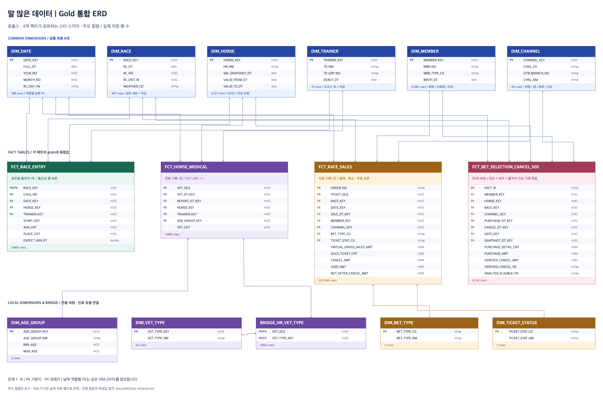
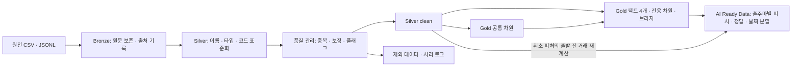

# 말 많은 데이터

**호올스 | 제주 경마 데이터 정제·스타 스키마·AI Ready Data 구축**

경주·마권·회원·말 진료 데이터를 연결하고, 정제 근거와 처리 이력을 추적할 수 있는 분석 데이터로 만듭니다.

> **진행 상태: Bronze → Silver → Gold → AI Ready Data 구축·검증 완료**

[프로젝트 위키 원고](docs/wiki/Home.md) · [상세 ERD·측정값](docs/wiki/Star-Schema.md) · [품질·검증 결과](docs/wiki/Results.md)

## 1. 팀 소개

**팀명: 호올스**

| 이름 | GitHub | Gold 담당 | 분석 주제 |
| --- | --- | --- | --- |
| 원주 | [@wonju0516](https://github.com/wonju0516) | 경주 출전 · 공통 차원 | 말·조교사·경주 조건별 출주·우승·입상 |
| 세은 | [@wlstpdms](https://github.com/wlstpdms) | 말 진료 | 말·나이대·조교사·진료 유형별 진료 건수 |
| 희정 | [@gmlwjd0055](https://github.com/gmlwjd0055) | 마권 매출 | 경주·승식·회원·채널별 매출 구성 |
| 은빈 | [@eunbinko](https://github.com/eunbinko) | 50대 단승 마권 취소 | 구매 당시 만 50~59세 회원의 단승 구매·취소 |

공용 파이프라인과 품질 규칙을 통합하고, 담당 주제별 Gold를 구축합니다.

## 2. 프로젝트 개요

### 프로젝트 소개

**프로젝트명: 말 많은 데이터**

제주 경마 관련 CSV·JSONL을 Bronze로 보존하고, Silver 표준화·품질 관리와 Gold 스타 스키마를 거쳐 **출전마의 3착 이내 여부를 예측하기 위한 AI Ready Data**를 구축했습니다. 출전·진료·매출·취소 정보를 결합하고, 경주 출발 전 정보만 학습 피처에 사용합니다.

[원천 데이터](data/00_origin/)는 전표·회원·말 관리·경주·진료·변경 공지의 6개 원천 시스템에서 나온 파일입니다.

| 원천 시스템 | 데이터 | 파일 수 | 원천 행 수 |
| --- | --- | ---: | ---: |
| `bet` | 전표 `bet_order`, 마권 `bet_ticket` | 2 | 551,323 |
| `mbr` | 회원 `MBR_MASTER` | 1 | 4,383 |
| `hms` | 말·조교사 주간 스냅샷 | 2 | 53,596 |
| `rms` | 경주·출전·배당·결과·승식별 매출 | 5 | 14,472 |
| `vms` | 말 진료 `HR_VET_HIST` | 1 | 1,488 |
| `mongodb` | 변경 공지 `race_change_events.jsonl` | 1 | 149 |
| **합계** | **CSV 11개 + JSONL 1개** | **12** | **625,411** |

경주 기간: **2026-05-22 ~ 2026-11-14** · 경마일 **52일** · 경주 **386개**. 테이블별 범위는 [데이터 안내서](docs/DATA_GUIDE.md)에서 확인할 수 있습니다.

### 원천 테이블별 한 행의 의미

행 수는 원천 기준이며, 키는 표준화 후 컬럼명으로 표기합니다. 마권의 업무 키는 중복 분리 후 유일해집니다.

| 원천 | 한 행의 의미 | 연결·식별 키 (Silver 기준) | 원천 행 수 | 쓰인 곳 |
| --- | --- | --- | ---: | --- |
| `bet_order` | 구매·취소 전표 1건 | `ORDER_NO` | 27,907 | 매출·취소 팩트, 회원·채널 연결 |
| `bet_ticket` | 전표 안의 마권 기록 1건 (경주·말·승식·금액) | `ORDER_NO + TICKET_SEQ` | 523,416 | 매출·취소 팩트; 완전 중복 1,052행 별도 보존 |
| `MBR_MASTER` | 회원 1명 | `MBR_NO` | 4,383 | `DIM_MEMBER`, 구매 당시 50대 여부 판별 |
| `HR_WEEKLY_SNAPSHOT` | 특정 스냅샷 날짜의 말 1두 상태 | `SNAPSHOT_DT + HR_NM` | 52,642 | `DIM_HORSE` SCD2, 과거 말 성적 |
| `TR_WEEKLY_SNAPSHOT` | 특정 스냅샷 날짜의 조교사 1명 상태 (53시점 × 18명) | `SNAPSHOT_DT + TR_NM` | 954 | `DIM_TRAINER` |
| `RC_RACE` | 경주 1개 | `RC_DT + RC_NO` | 386 | `DIM_RACE`, 출발 시각 기준 |
| `RC_ENTRY` | 경주별 출전표에 오른 말 1두 | `RC_DT + RC_NO + CHUL_NO` | 3,666 | 출전 팩트의 grain |
| `RC_ODDS` | 출전마 1두의 배당·구간 기록 | `RC_DT + RC_NO + CHUL_NO` | 3,666 | 출전 팩트 `EXPECT_WIN`, AI Ready 비교 기준선 |
| `RC_RESULT` | 출전마 1두의 경주 결과 | `RC_DT + RC_NO + CHUL_NO` | 3,666 | 출주·우승·입상 측정값, AI Ready 정답 |
| `RC_SALES` | 경주 × 승식 매출 1건 또는 경주 합계 1행 | 승식별: `RC_DT + RC_NO + BET_TYPE_CD` 합계: `RC_DT + RC_NO` | 3,088 | Silver에서 승식별 2,702행·합계 386행 분리·대사 |
| `HR_VET_HIST` | 말 진료 1건 (복수 진료명이 한 칸에 포함될 수 있음) | `VET_SEQ` (Silver에서 원천 행 번호로 부여) | 1,488 | 진료 팩트·진료 유형 브리지 |
| `race_change_events` | 기수변경·말취소·주로상태 공지 1건 | `_SRC_ROW_NO` (원천 JSON 행 번호) | 149 | `RC_CHANGE_EVENT`로 표준화해 Silver에 보존 |

[원천 컬럼 설명](docs/BRONZE_COLUMNS.md) · [표준화 후 컬럼 설명](docs/SILVER_COLUMNS.md)

### 프로젝트 필요성: AS-IS

| 원천 문제 | 실제 확인 내용 | 처리 방향 |
| --- | --- | --- |
| 이름·날짜·코드 혼용 | `order_no` / `RC_DATE` / `rcDate`, 여러 날짜 형식, 한글·영문 승식 | 표준 이름·타입·코드 적용 |
| 복합값·단위 혼재 | 체중+증감, 분:초 기록, 복수 진료명, 만원·천원 | 의미별 컬럼·브리지 분리, 단위 통일 |
| 마권 완전 중복 | 1,052행 | 유지 행을 결정하고 중복은 추적 정보와 함께 별도 보존 |
| 마명 누락 | 원천 1,563행, 중복 제거 후 1,560행 | 경주·마번으로 출전표와 연결해 보정 |
| 업무상 확인이 필요한 기록 | 0원 마권, 늦은 취소, 전표 헤더·상세 불일치 | 품질 플래그와 처리 근거 기록 |
| 시점에 따른 속성 변화 | 말의 등급·소속 조·조교사 등 변경 | SCD2 이력 차원, 기준일 이전 스냅샷 사용 |

그대로 결합하면 중복으로 집계가 부풀거나 취소·미출주 기록을 잘못 해석할 수 있습니다. 원천 문제의 건수·변환 예시는 [AS-IS 보고서](docs/AS-IS.md), 처리 근거는 [결정 로그](meta/decision_log.md)에 기록합니다.

### 프로젝트 목표

- 원천을 보존하고, 각 행의 유지·보정·제외 사유를 추적합니다.
- 표준화와 품질 관리를 분리하고 단계별 행 수·키·측정값을 대사합니다.
- 팀원별 스타 스키마를 구성하고 공통 차원으로 경주·말·회원 등을 일관되게 연결합니다.
- 같은 입력·규칙으로 같은 결과를 재현하고, AI 활용에 필요한 시점·결측·품질 이슈를 명시합니다.

## 3. 기술 스택

| 구분 | 기술 | 용도 |
| --- | --- | --- |
| 처리 언어 |  | 적재·변환·검증 스크립트 |
| 데이터 처리 |  | 표준화·조인·집계·품질 규칙 계산 |
| 컬럼형 저장 |   | 타입을 갖는 데이터 저장·조회 |
| 입력 형식 |  · JSONL | 테이블·중첩 이벤트 원천 |
| 설계·문서 |  · Mermaid | 규칙서·품질 보고서·ERD |

의존성은 [requirements.txt](requirements.txt)로 관리합니다. 변경 공지는 JSONL 파일로 처리합니다.

## 4. WBS

| WBS | 일정 | 작업 | 산출물 | 상태 |
| --- | --- | --- | --- | --- |
| 1 | 11/20 | 원천 데이터 공유·처리 규칙 정의 | 원천 12개·매핑 규칙서·결정 로그 | ✅ |
| 2 | 11/20 | Bronze 적재·행 수 대사 | Parquet 12개·적재 로그 | ✅ |
| 3 | 11/20 | 표준화·변환 기록 | Silver 14개·데이터 사전·변환 로그 | ✅ |
| 4 | 11/20 | 품질 검증·정제 결과 통합 | clean·제외 데이터·품질 로그 | ✅ |
| 5 | 11/20~11/23 | 스타 스키마 설계·Gold 생성 | 팩트 4개·전용 차원·브리지 | ✅ |
| 6 | 11/23 | 공통 차원 통합·Gold 검증 | 공통 차원 6개·PK/FK·측정값 대사 | ✅ |
| 7 | 11/23 | AI Ready Data 구성·검증 | 출주마 3,644행·인코딩 테이블·TRAIN/TEST 날짜 분할 | ✅ |

[세부 일정·산출물](docs/wiki/WBS.md)

## 5. 요구사항 명세서

| ID | 단계 | 핵심 요구사항 | 검증 방법 | 결과 |
| --- | --- | --- | --- | --- |
| B-01 | Bronze | 원천을 값 변경 없이 Parquet로 보존하고 파일별 행 수를 일치시킨다. | [01_bronze_check.py](src/01_bronze_check.py) | ✅ 12개·625,411행 일치 |
| B-02 | Bronze | 원천 파일·적재 시각·행 번호·해시를 기록해 출처와 재적재 이력을 추적한다. | [01_bronze_check.py](src/01_bronze_check.py) · 적재 로그 | ✅ 출처·원천 해시 확인 |
| N-01 | 표준화 | 컬럼명·날짜·타입·코드·단위를 통일하고 데이터 사전에 기록한다. | [02_normalize_check.py](src/02_normalize_check.py) · 사전/스키마 대조 | ✅ 변환 실패·코드표 밖 값 0건 |
| N-02 | 표준화 | 기본 행을 보존하고, 매출 합계 분리·진료 브리지 확장은 출력 단위에 맞게 대사한다. | [02_normalize_check.py](src/02_normalize_check.py) | ✅ 매출 3,088 = 2,702 + 386, 진료명 항목 1,664개 |
| N-03 | 표준화 | 원천값의 변경·NULL 처리·제외 사유를 기록한다. | [02_normalize_check.py](src/02_normalize_check.py) · 데이터 사전·이슈 로그 | ✅ 원천 컬럼 기록·값 보존 대사 통과 |
| Q-01 | 품질 검증 | 6개 품질 차원의 규칙을 정의하고 근거 결정 ID를 연결한다. | [03_quality_check.py](src/03_quality_check.py) · 결정 로그 | ✅ 26개 규칙 근거 확인 |
| Q-02 | 품질 검증 | 키·금액·참조·시점을 점검하고 위반 행의 처리 근거를 남긴다. | [03_quality_check.py](src/03_quality_check.py) · 규칙별 결과 | ✅ 확인용 16개 규칙 위반 0, 표시·보정 이력 보존 |
| S-01 | Silver | 완전 중복을 분리 보존하고 입력 = 유지 + 제외, 유지·제외 겹침 0을 확인한다. | [03_quality_check.py](src/03_quality_check.py) | ✅ 마권 523,416 = 522,364 + 1,052행 |
| S-02 | Silver | 마명을 근거에 따라 보정하고 0원·늦은 취소·불일치는 플래그로 보존한다. | [03_quality_check.py](src/03_quality_check.py) | ✅ 마명 1,560행 보정·플래그 재계산 일치 |
| S-03 | Silver | 정제 결과를 공용 clean으로 관리하고 버전·파일 해시를 고정한다. | [clean manifest](data/02_silver/clean/_manifest.json) · SHA-256 대조 | ✅ 14개 파일 일치 |
| G-01 | Gold | 같은 clean에서 업무별 grain에 맞는 팩트와 공통 차원을 생성한다. | 팩트별 입력·grain 대사 | ✅ 팩트 4개·공통 차원 6개 |
| G-02 | Gold | PK 중복·NULL과 FK 누락이 없어야 하며 말의 SCD2 기준일을 지킨다. | [공통 차원 검증](src/common/04_common_dims_check.py) · 팩트별 키/시점 검증 | ✅ 키 오류 0건·기간 검증 통과 |
| G-03 | Gold | 팩트·브리지의 행 수와 측정값을 해당 입력·집계 정의에 맞춰 대사한다. | [팩트별 검증 결과](docs/wiki/Results.md) | ✅ 행 수·금액·건수 일치 |
| A-01 | AI Ready | 실제 출주마 1두를 1행으로 구성하고 미출주마는 사유와 함께 별도 보존한다. | [05_ai_ready_check.py](src/ai_ready/05_ai_ready_check.py) | ✅ 유지 3,644 + 제외 22 = 3,666행, PK 중복 0 |
| A-02 | AI Ready | 출발 전 정보로 피처를 구성하고 정답·최종 배당을 학습 피처와 분리한다. | [05_ai_ready_check.py](src/ai_ready/05_ai_ready_check.py) · 과거 성적/진료/거래 재계산 | ✅ 시점별 재계산 일치 |
| A-03 | AI Ready | 범주형을 인코딩하고 결측 표시를 유지해 학습 피처를 숫자형으로 만든다. | [05_ai_ready_check.py](src/ai_ready/05_ai_ready_check.py) · 원-핫/결측 검증 | ✅ 행·순서 일치, 결측 0건 |
| A-04 | AI Ready | 정답은 3착 이내 여부로 정의하고 TRAIN/TEST를 날짜로 분할한다. | [05_ai_ready_check.py](src/ai_ready/05_ai_ready_check.py) · 정답/분할 검증 | ✅ TRAIN 2,895행·TEST 749행, 날짜 겹침 0 |

## 6. ERD

공통 차원과 네 팩트를 하나의 ERD로 표현한 스타 스키마 통합 모델입니다.

[draw.io 편집 원본 다운로드](docs/diagrams/gold-star-schema.drawio) · [이미지 확대 보기](docs/diagrams/gold-star-schema.svg)

공통 차원 6개, 팩트 4개, 전용 차원 4개와 진료 브리지의 주요 컬럼·PK·FK를 표시합니다. 원본 파일을 draw.io에서 열어 편집할 수 있습니다.

### 팩트 grain

| 주제 · 팩트 | 한 행의 의미 | PK | 주요 측정값 | 실제 행 수 |
| --- | --- | --- | --- | ---: |
| [경주 출전](docs/gold/race_entry.md) · `FCT_RACE_ENTRY` | 경주별 출전표에 오른 말 1두 | `RACE_KEY + CHUL_NO` | `START_CNT`, `WIN_CNT`, `PLACE_CNT`, `EXPECT_WIN` | 3,666 |
| [말 진료](docs/gold/horse_medical.md) · `FCT_HORSE_MEDICAL` | 진료 기록 1건 | `VET_SEQ` | `VET_CNT` | 1,488 |
| [마권 매출](docs/gold/race_sales.md) · `FCT_RACE_SALES` | 전표 내 마권 기록 1건(발매·취소·무효 포함) | `ORDER_NO + TICKET_SEQ` | `VIRTUAL_GROSS_SALES_AMT`, `SOLD_TICKET_CNT`, `CANCEL_AMT`, `VOID_AMT`, `NET_AFTER_CANCEL_AMT` | 522,364 |
| [50대 단승 취소](docs/gold/bet_cancel.md) · `FCT_BET_SELECTION_CANCEL_50S` | 만 50~59세 회원의 전표별·경주별·출주마별 단승 구매 묶음 | `FACT_ID` | `PURCHASE_DETAIL_COUNT`, `PURCHASE_AMOUNT_KRW`, `VERIFIED_CANCEL_AMOUNT_KRW`, `HAS_VERIFIED_CUSTOMER_CANCEL` | 41,141 |

### 공통 차원

| 공통 차원 | PK | 행 수(미상 포함) | 주요 속성·연결 기준 |
| --- | --- | ---: | --- |
| `DIM_DATE` | `DATE_KEY` | 188 | 연속 187일 + 미상. 경주·구매·취소·진료·보고·스냅샷 날짜를 역할별 FK로 연결 |
| `DIM_RACE` | `RACE_KEY` | 387 | 경주 386개 + 미상. 경주일·경주번호, 거리·등급·날씨·주로 |
| `DIM_HORSE` | `HORSE_KEY` | 4,127 | 말 1,250두의 SCD2 버전 4,126개 + 미상. 기준일 이전 스냅샷 사용 |
| `DIM_TRAINER` | `TRAINER_KEY` | 19 | 조교사 18명 + 미상. 조교사명·소속 조 |
| `DIM_MEMBER` | `MEMBER_KEY` | 4,385 | 회원 4,383명 + 비회원 + 미상. 비회원은 별도 양수 키 |
| `DIM_CHANNEL` | `CHANNEL_KEY` | 40 | 현장·앱·장외 37개 지점 + 미상. 채널·지점 조합 |

미상 키는 `0`입니다. 말의 SCD2 버전은 스냅샷 다음 날부터 유효하며, `VALID_FROM_DT ≤ 기준일 ≤ VALID_TO_DT`로 연결합니다.

[측정값 계산 정의](docs/wiki/Star-Schema.md#측정값) · [공통 차원 연결 규칙](docs/gold/common.md)

## 7. 주요 프로시저

1. **Bronze:** 원천 문자열·JSON 원문을 Parquet로 보존하고 출처·행 번호·SHA-256을 기록합니다. 같은 파일 해시는 기존 적재 시각을 재사용합니다.
2. **Silver 표준화:** 입력 행을 보존하면서 이름·타입·단위·코드를 통일합니다. 매출 합계 행을 분리하고 진료명을 브리지로 펼칩니다.
3. **품질 관리:** 완전 중복을 먼저 분리한 뒤 보정·플래그를 계산합니다. 표준화 결과와 clean을 분리하고 행별 규칙·결정 ID를 기록합니다. 진료 유형 통합은 원래 진료 기록을 보존하며 브리지를 다시 구성합니다.
4. **Gold:** 공용 clean manifest의 버전을 기준으로 공통 차원과 각 grain의 팩트·전용 차원을 생성합니다. PK·FK·행 수·측정값을 대사합니다.
5. **AI Ready Data:** 실제 출주마별 과거 성적·진료·매출·취소 피처와 `PLACE_YN` 정답을 결합합니다. 취소는 clean 거래에서 출발 전 정보만으로 다시 판정하며, 날짜 기준 TRAIN/TEST 분할과 모델 입력용 인코딩을 적용합니다.

[전체 실행 순서·디렉터리 구조](docs/wiki/Data-Pipeline.md)

### 표준화 규칙 요약

Bronze의 원천값은 보존하고 Silver에서 이름·타입·단위·코드를 통일합니다. 표준화 단계에서는 기본 테이블의 행을 삭제하지 않습니다.

| 구분 | 규칙 | 예시 |
| --- | --- | --- |
| 이름 | 테이블·컬럼은 `UPPER_SNAKE_CASE`, 공통 약어 사용 | `order_no` / `rcDate` → `ORDER_NO` / `RC_DT` |
| 접미사 | 일자 `_DT`, 일시 `_DTM`, 시각 `_TM`, 금액 `_AMT`, 건수 `_CNT`, 코드 `_CD`, 여부 `_YN`, 이름 `_NM` | `SALE_DTM`, `BET_AMT`, `TR_EXTERNAL_YN` |
| 식별 번호 | 전표·회원·소속 조 식별자는 `VARCHAR`, 앞자리 0 유지 | `ORDER_NO`, `MBR_NO`, `TR_GRP_NO = '08'` |
| 타입 | 건수·순위·나이는 `INT`, 금액은 컬럼별 `INT`/`BIGINT`, 소수는 `DECIMAL(p,s)` | `BET_AMT`: `INT`, `TOTAL_AMT`: `BIGINT`, `RC_TIME_SEC`: `DECIMAL(5,1)` |
| 날짜·일시 | `YYYYMMDD`, `YYYY.MM.DD`, `YYYY/MM/DD` 등 지정 형식을 차례로 시도해 `DATE`·`TIMESTAMP`(KST)로 통일 | `20260522` → `2026-05-22`, `10:45` → `10:45:00` (`TIME`) |
| 단위 | 금액은 원, 무게는 kg, 시간 길이는 초, 거리는 m | `700만원` → `7,000,000`원, `1:13.2` → `73.2`초 |
| 코드 | 한글·영문·대소문자 혼용 값을 공통 코드표로 매핑 | `단승`·`단식`·`WIN` → `WIN`, `수/암/거` → `M/F/G` |
| 빈 값 | 문자열 앞뒤 공백 제거, 빈 문자열·공백·`-----`는 NULL | 비회원의 빈 회원번호는 NULL로 보존 |
| 쪼개기 | 복합값은 의미별 컬럼이나 브리지로 분리 | `279+14` → 체중 279·증감 +14, `정치,낭치` → 진료 유형 브리지 2행 |
| 이름 충돌 | 같은 이름이 다른 뜻이면 컬럼명을 구분 | `ticket_cnt` → `TICKET_CNT`(전표의 마권 장수) / `UNIT_CNT`(마권 구좌 수) |

변환 실패·코드표 밖 값·규칙상 NULL 처리는 원천 행 번호와 함께 기록합니다. 소수의 정밀도 초과나 반올림이 필요한 값도 변환 실패로 남깁니다.

전체 규칙은 [매핑 규칙서](meta/mapping_rules.md), 컬럼별 타입·원천 컬럼은 [데이터 사전](meta/data_dictionary.csv), 변환 근거는 [이슈 로그](meta/silver_issue_log.csv)에서 확인할 수 있습니다.

### AI Ready Data

| 항목 | 내용 |
| --- | --- |
| 예측 대상 · 정답 | 실제 출주마의 3착 이내 여부 · `PLACE_YN` (0/1) |
| 입력 피처 | 인코딩 전 27개. 식별자·분할 코드·정답·배당 기준선 제외 |
| 전체 정답 비율 | 3착 이내 1,158 / 3,644행 = **31.8%** |
| 행 단위 · PK | 경주별 실제 출주마 1두 · `RACE_KEY + CHUL_NO` |
| 행 수 대사 | 출전표 3,666 = 유지 3,644 + 미출주 제외 22행 (`NOT_STARTED`) |
| TRAIN | 2026-10-09까지 · 2,895행 |
| TEST | 2026-10-10부터 · 749행 |
| 산출물 | 사람이 읽는 피처 테이블 · 모델 입력용 인코딩 테이블 · 제외 데이터 |
| TEST 비교 기준 | 경주마다 3두를 골랐을 때 실제 3착 이내 비율. 무작위로 고르면 **31.0%**, 배당 인기 상위 3두를 고르면 **52.4%** (231두 중 121두) |

| 피처 출처 | 핵심 내용 |
| --- | --- |
| 출전 | 말·경주 조건, 경주일 이전 출주·입상 성적 |
| 진료 | 진료일·보고일 모두 경주일 이전인 30일·90일 진료와 파행 여부 |
| 매출 | 출발 전 발매액·마권 수·취소액·취소율 |
| 50대 단승 취소 | 출발 전 구매와 확인 취소의 건수·금액; 원구매 연결도 출발 전 판매로 제한 |

비교 기준은 모델 없이 간단한 방법으로 맞혔을 때의 점수로, 이 데이터로 모델을 만들면 넘어야 할 선입니다. TEST 77경주에서 경주마다 3두를 골라(총 231두) 그중 실제로 3착 이내에 든 비율을 셉니다(Precision@3). 무작위 31.0%는 아무 정보 없이 찍은 점수이고, 배당 52.4%는 사람들이 많이 건 말을 따른 점수입니다. 전체 정답 비율 31.8%와는 집계 범위가 다르고, 최종 배당은 사후 비교용이라 모델 학습 성능이 아닙니다. 계산은 [05_ai_ready_check.py](src/ai_ready/05_ai_ready_check.py) [6]에서 다시 확인합니다.

범주형은 원-핫, Y/N은 1/0으로 인코딩하고 결측값은 0과 `_NA` 표시로 구분합니다. 최종 배당 `BASE_EXPECT_WIN`은 비교용 기준선이며 학습 입력에서 제외합니다. 날씨·주로 상태는 출발 전에 공개된 값으로 가정합니다.

[AI Ready 데이터·피처 정의](docs/ai_ready.md) · [산출물](data/04_ai_ready) · [05_ai_ready_check.py](src/ai_ready/05_ai_ready_check.py)

## 8. 수행결과

| 단계·대상 | 처리 전 | 처리 후 |
| --- | --- | --- |
| 원천 → Bronze | 12개·625,411행 | 12개·625,411행, 원천값 보존 |
| 표준화 | Bronze 12개 | Silver 14개·627,075행, 매출 분리·진료 브리지 확장 |
| 마권 중복 | 523,416행 | 유지 522,364행 + 별도 제외 1,052행 |
| 마명 보정 | 중복 제거 후 빈칸 1,560행 | 보정 1,560행, 빈칸 0건 |
| 진료 유형 통합 | 브리지 1,664행 | 브리지 1,662행, 원래 진료 기록 보존 |
| Silver clean 전체 | 표준화 627,075행 | 626,021행, 중복 제외·브리지 통합 반영 |
| Gold 출전 | 출전표 3,666행 | 팩트 3,666행·실제 출주 3,644 |
| Gold 진료 | 진료 1,488행·유형 연결 1,662행 | 팩트·브리지 행 수 일치 |
| Gold 매출 | clean 마권 522,364행 | 팩트 522,364행·정상 발매액 1,903,091,700원 |
| Gold 취소 | 대상 구매 상세 61,430행 | 구매 묶음 41,141행 = 적격 39,284 + 분석 제외 1,857 |
| Gold 키 검증 | 팩트·차원·브리지 | PK 중복·NULL 및 FK 누락 0건 |
| AI Ready 행 대사 | 출전표 3,666행 | 유지 3,644 + 미출주 제외 22행 |
| AI Ready 날짜 분할 | 실제 출주 3,644행 | TRAIN 2,895행 + TEST 749행 |
| AI Ready 인코딩 | 코드값·결측이 있는 피처 | 같은 3,644행, 인코딩 결측 0건 |

0원 마권 3,632행·늦은 취소 마권 1,000행·헤더 불일치 전표 93행 등은 품질 플래그로 보존합니다. 분석 제외 구매 묶음도 사유와 함께 팩트에 유지합니다.

[전체 전후 비교·Gold 금액 대사·잔여 이슈·검증 명령](docs/wiki/Results.md)

## 9. 한 줄 회고

<table>
  <thead><tr><th width="140" align="left">팀원</th><th align="left">한 줄 회고</th></tr></thead>
  <tbody>
  <tr><td width="140">목원주</td><td>전체 틀을 잡고 이러한 프로젝트를 진행해 보면서 코드는 AI가 짜 줄 수 있어도 데이터 도메인을 모르면 결과가 맞는지조차 판단할 수 없다는 걸 배웠습니다. 깃허브 브랜치 관리가 부족했던 만큼 다음에는 처음부터 규칙을 정하고 관리하겠습니다.</td></tr>
  <tr><td width="140">진세은</td><td>새로운 관점의 주제 선정과 GitHub 협업 환경 구축은 좋았지만 데이터 부족과 AI 의존으로 전체 과정을 충분히 이해하지 못한 점이 아쉬웠다. 앞으로는 팀원들과 더 소통하고 AI를 활용한 결과물을 내 것으로 만드는 능력을 키워야겠다.</td></tr>
  <tr><td width="140">전희정</td><td>주제를 제안했지만 관련 지식이 부족했던 점이 아쉬웠고, 앞으로는 주제에 대한 이해를 높이고 AI 활용 시에도 docs의 기준 문서를 확인·관리하며 일관된 규칙으로 작업하는 습관을 들이겠습니다.</td></tr>
  <tr><td width="140">고은빈</td><td>의견을 잘 듣고 데이터를 직접 확인하여 리뷰해주는 좋은 점은 유지하면서, 부족한 분야의 지식을 공부하고 분석에 필요한 팩트테이블 데이터를 더 신중하게 선택해야겠습니다.</td></tr>
  </tbody>
</table>
