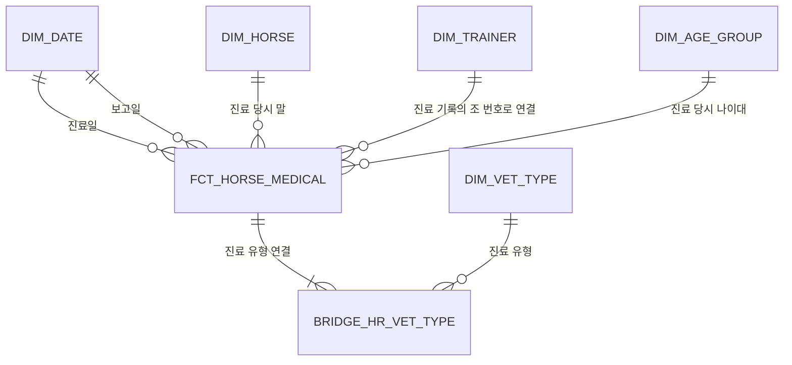

# mlo-03-p2-team3

원천 데이터 → Bronze → Silver → 품질 관리 → Gold → AI Ready Data

## 디렉토리 구조

```
.
├── data/
│   ├── 00_origin/   # 원천 데이터 (읽기 전용, 수정·이동·덮어쓰기 금지)
│   ├── 01_bronze/   # 원천 → Parquet (어느 파일을 언제 가져왔는지 기록)
│   ├── 02_silver/   # 컬럼명·날짜·데이터 타입·논리값 표준화
│   │   ├── clean/       # 확정 규칙을 적용한 품질관리 입력
│   │   └── _excluded/   # 품질관리에서 제외한 마권 중복행
│   └── 03_gold/     # 스타 스키마 (fact / dim)
├── src/             # 파이썬 코드 (단계별 처리 + 검증)
├── docs/            # AS-IS 문제 정리, 품질 관리 보고서
├── meta/            # 메타데이터 (데이터 사전, 데이터 설명서, 변경 내역)
└── AGENTS.md        # AI 에이전트·팀원 작업 규칙
```

- `main`의 `data/`에는 팀 공용 원천 파일과 폴더 구조를 공유합니다. Bronze·Silver·Gold 처리는 각자의 작업 브랜치에서 진행합니다.

## 공용 원천의 Bronze·Silver 처리

`feat/fct-horse-medical`에서 공용 원천 12개를 Bronze Parquet 12개로 적재하고, 팀 공용 매핑 규칙에 맞춰 Silver 14개 테이블로 표준화합니다. 경주 매출 합계와 진료 유형 브리지는 별도 테이블로 생성합니다.

```powershell
python -m pip install -r requirements.txt
python src/01_bronze.py
python src/01_bronze_check.py
python src/02_normalize.py
python src/02_normalize_check.py
```

[전체 원천 AS-IS 프로파일링](docs/AS-IS.md) · [팀 공용 매핑 규칙](meta/mapping_rules.md) · [파일별 입출력과 검증 기록](meta/README.md)

## 진료 이력 데이터

원천은 `data/00_origin/horse/HR_VET_HIST.csv`이며, 진료 이력 1,488행과 6개 컬럼으로 구성됩니다.

### 원천 데이터 프로파일링

| 확인 항목 | 결과 |
|---|---|
| 날짜 형식 | 진료일은 `YYYY.MM.DD`, 보고일은 `YYYYMMDD` |
| 조 번호 | 앞자리에 `0`이 있는 값이 667행에 있어 문자열로 보존 |
| 복수 진료명 | 176행에 쉼표로 구분된 진료명이 포함됨 |
| 결측·완전 중복·날짜 파싱 실패 | 각각 0건 |

### Bronze·Silver 검증 결과

| 단계 | 산출물 | 검증 결과 |
|---|---|---|
| Bronze | `HR_VET_HIST.parquet`, `bronze_load_log.csv` | 1,488행. 원천 6개 컬럼의 이름·순서·값을 보존하고 추적용 컬럼 4개를 추가 |
| Silver 진료 이력 | `HR_VET_HIST.parquet` | 1,488행. 표준 컬럼 7개와 원천 행 번호 `_SRC_ROW_NO`를 저장 |
| Silver 진료 유형 브리지 | `HR_VET_TYPE_BRIDGE.parquet` | 1,664행. 표준 컬럼 2개와 `_SRC_ROW_NO`를 저장하고 `VET_SEQ`로 진료 이력에 연결 |

[AS-IS 상세 프로파일링](docs/HR_VET_HIST_AS_IS.md) · [파일별 입출력과 컬럼 매핑](meta/HR_VET_HIST_DATA_DICTIONARY.md)

## 품질관리 입력

표준화 Parquet 14개는 `data/02_silver/`에 보존합니다. 품질관리 입력은 경주 브랜치의 커밋 `8a129d0`에 있는 `data/02_silver/clean/` Parquet 14개를 그대로 사용합니다. 원본과 파일별 SHA-256이 같음을 확인했고, [버전 기록](data/02_silver/clean/_manifest.json)에 참조 커밋과 `CLEAN_VERSION`을 남겼습니다.

마권 중복 1,052행은 `data/02_silver/_excluded/`에 따로 보존합니다. 진료 이력은 1,488행을 모두 유지하고, 조 번호 불일치 11건과 이전 스냅샷 없음 71건을 표시했습니다. 595번·664번의 원문 `일,열사병`을 보존하면서 각 기록의 유형을 `일·열사병` 하나로 묶어, 브리지 행 수를 1,664행에서 1,662행으로 대사했습니다.

```powershell
python src/03_quality_check.py
```

[품질관리 상세 보고서](docs/품질관리.md) · [규칙별 결과](meta/dq_result.csv) · [행별 변경 기록](meta/dq_log.csv)

## 진료 Gold 스타 스키마

`FCT_HORSE_MEDICAL`의 한 행은 **진료 기록 1건**입니다. `VET_SEQ`를 기본키로 두고 `VET_CNT=1`을 합산해 진료 건수를 계산합니다. 진료일과 보고일은 같은 날짜 차원에 각각 연결합니다. 유형별 건수는 `BRIDGE_HR_VET_TYPE`를 통해 집계합니다. 여러 유형이 붙는 기록이 있으므로, 전체 기록 건수는 Fact에서 집계합니다.



### 개인 진료 Gold 생성과 검증

`data/03_gold/horse_medical/`에 개인 진료 Gold 7개 테이블을 저장했습니다. 경주 브랜치 `8a129d0`의 날짜·말·조교사 차원에 있던 행과 키를 보존하고, 날짜 차원에 진료·보고 기간을 덮는 10일을 추가했습니다. 이전 스냅샷이 없는 진료 71건은 추가한 미확인 말 키 `0`으로 연결했습니다.

진료일에 유효한 말 SCD2 버전의 `HR_AGE`를 2~3세, 4~5세, 6~7세, 8세 이상으로 나눕니다. 조교사 키는 진료 이력의 `TR_GRP_NO`로 연결합니다. 조 번호 불일치나 이전 스냅샷 여부를 분석할 때는 `VET_SEQ`로 `clean/HR_VET_HIST.parquet`의 품질 플래그를 확인할 수 있습니다.

```powershell
git fetch origin
$reference = "8a129d06e52f05e5e8ec36ec33cda3b4b1ae5d6a"
$cleanVersion = "948fe690c7a42511710c7264904d9ada523c5aeb12b118aa570a423dce428b6c"
python src/04_gold_horse_medical.py --reference-rev $reference --clean-version $cleanVersion
```

| 산출물 | 결과 |
|---|---:|
| 진료 Fact 및 진료 건수 합 | 1,488 |
| 진료 유형 브리지 | 1,662 |
| 진료 유형 | 53종 |
| 기본키 중복 | 0건 |
| 미해결 외래키 | 0건 |

[Gold 검증과 입력 버전 기록](data/03_gold/horse_medical/_manifest.json)

### 팀 공통 차원 통합

팀이 공통 차원을 통합한 뒤에는 확정한 `clean/`을 유지하고 아래 명령으로 Fact의 외래키를 다시 연결합니다(D-010, D-012).

```powershell
python src/04_gold_horse_medical.py --common-dims "공통차원폴더" --clean-version $cleanVersion
```

| 공통 차원 파일 | 연결에 필요한 컬럼 |
|---|---|
| `DIM_DATE.parquet` | `DATE_KEY`, `FULL_DT` |
| `DIM_HORSE.parquet` | `HORSE_KEY`, `HR_NM`, `HR_AGE`, `VALID_FROM_DT`, `VALID_TO_DT` |
| `DIM_TRAINER.parquet` | `TRAINER_KEY`, `TR_GRP_NO` |
| `DIM_AGE_GROUP.parquet` | `AGE_GROUP_KEY`, `MIN_AGE`, `MAX_AGE` |

공통 차원으로 생성한 결과에는 입력 `CLEAN_VERSION`과 차원 파일 해시를 기록합니다. 기본키 중복과 외래키 검증의 근거는 AGENTS.md 7번입니다.
