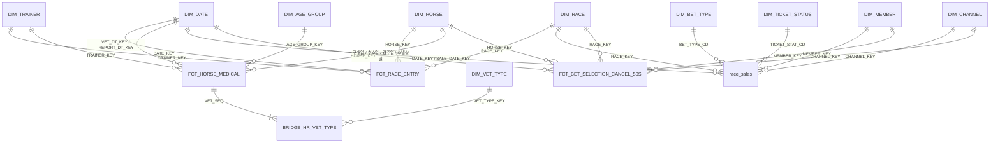
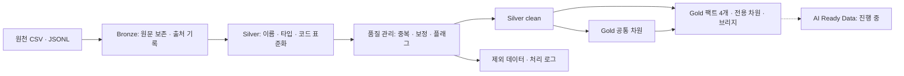

# 말 많은 데이터

**호올스 | 제주 경마 데이터 표준화·품질 관리·스타 스키마 구축**

경주·마권·회원·말 진료 데이터를 연결하고, 정제 근거와 처리 이력을 추적할 수 있는 분석 데이터로 만듭니다.

> **진행 상태: Gold 완료 · AI Ready Data 진행 중**

[프로젝트 위키 원고](docs/wiki/Home.md) · [상세 ERD·측정값](docs/wiki/Star-Schema.md) · [품질·검증 결과](docs/wiki/Results.md)

## 1. 팀 소개

**팀명: 호올스**

| 이름 | GitHub | Gold 담당 | 분석 주제 |
| --- | --- | --- | --- |
| 원주 | [@wonju0516](https://github.com/wonju0516) | 경주 출전 · 공통 차원 | 말·조교사·경주 조건별 출주·우승·입상 |
| 세은 | [@wlstpdms](https://github.com/wlstpdms) | 말 진료 | 말·나이대·조교사·진료 유형별 진료 건수 |
| 희정 | [@gmlwjd0055](https://github.com/gmlwjd0055) | 마권 매출 | 경주·승식·회원·채널별 매출 구성 |
| 은빈 | [@eunbinko](https://github.com/eunbinko) | 50대 단승 마권 취소 | 구매 당시 만 50~59세 회원의 단승 구매·취소 |

공용 파이프라인과 품질 규칙을 통합하고, 담당 주제별 Gold를 구축합니다.

## 2. 프로젝트 개요

### 프로젝트 소개

**프로젝트명: 말 많은 데이터**

저장소에 제공된 제주 경마 관련 CSV·JSONL을 Bronze로 보존하고, Silver에서 표준화·품질 관리를 수행한 뒤, 네 가지 업무 주제의 Gold 스타 스키마로 구성합니다. 이후 AI Ready Data로 확장하는 것을 목표로 합니다.

[원천 데이터](data/00_origin/)는 전표·회원·말 관리·경주·진료·변경 공지의 6개 논리 시스템으로 구성됩니다.

| 원천 시스템 | 데이터 | 파일 수 | 원천 행 수 |
| --- | --- | ---: | ---: |
| `bet` | 전표 `bet_order`, 마권 `bet_ticket` | 2 | 551,323 |
| `mbr` | 회원 `MBR_MASTER` | 1 | 4,383 |
| `hms` | 말·조교사 주간 스냅샷 | 2 | 53,596 |
| `rms` | 경주·출전·배당·결과·승식별 매출 | 5 | 14,472 |
| `vms` | 말 진료 `HR_VET_HIST` | 1 | 1,488 |
| `mongodb` | 변경 공지 `race_change_events.jsonl` | 1 | 149 |
| **합계** | **CSV 11개 + JSONL 1개** | **12** | **625,411** |

경주 기간: **2026-05-22 ~ 2026-11-14** · 경마일 **52일** · 경주 **386개**. 테이블별 범위는 [데이터 안내서](https://github.com/encore-ai-campus/mlo-03-p2-team3/blob/develop/docs/DATA_GUIDE.md)에서 확인할 수 있습니다.

### 프로젝트 필요성: AS-IS

| 원천 문제 | 실제 확인 내용 | 처리 방향 |
| --- | --- | --- |
| 이름·날짜·코드 혼용 | `order_no` / `RC_DATE` / `rcDate`, 여러 날짜 형식, 한글·영문 승식 | 표준 이름·타입·코드 적용 |
| 복합값·단위 혼재 | 체중+증감, 분:초 기록, 복수 진료명, 만원·천원 | 의미별 컬럼·브리지 분리, 단위 통일 |
| 마권 완전 중복 | 1,052행 | 유지 행을 결정하고 중복은 추적 정보와 함께 별도 보존 |
| 마명 누락 | 원천 1,563행, 중복 제거 후 1,560행 | 경주·마번으로 출전표와 연결해 보정 |
| 업무상 확인이 필요한 기록 | 0원 마권, 늦은 취소, 전표 헤더·상세 불일치 | 품질 플래그와 처리 근거 기록 |
| 시점에 따른 속성 변화 | 말의 등급·소속 조·조교사 등 변경 | SCD2 이력 차원, 기준일 이전 스냅샷 사용 |

그대로 결합하면 중복으로 집계가 부풀거나 취소·미출주 기록을 잘못 해석할 수 있습니다. 원천 문제의 건수·변환 예시는 [AS-IS 보고서](https://github.com/encore-ai-campus/mlo-03-p2-team3/blob/develop/docs/AS-IS.md), 처리 근거는 [결정 로그](https://github.com/encore-ai-campus/mlo-03-p2-team3/blob/develop/meta/decision_log.md)에 기록합니다.

### 프로젝트 목표

- 원천을 보존하고, 각 행의 유지·보정·제외 사유를 추적합니다.
- 표준화와 품질 관리를 분리하고 단계별 행 수·키·측정값을 대사합니다.
- 팀원별 스타 스키마를 구성하고 공통 차원으로 경주·말·회원 등을 일관되게 연결합니다.
- 같은 입력·규칙으로 같은 결과를 재현하고, 후속 AI 활용에 필요한 시점·결측·품질 이슈를 명시합니다.

## 3. 기술 스택

| 구분 | 기술 | 용도 |
| --- | --- | --- |
| 처리 언어 |  | 적재·변환·검증 스크립트 |
| 데이터 처리 |  | 표준화·조인·집계·품질 규칙 계산 |
| 컬럼형 저장 |   | 타입을 갖는 데이터 저장·조회 |
| 입력 형식 |  · JSONL | 테이블·중첩 이벤트 원천 |
| 협업·이력 | Git · GitHub | 브랜치·커밋·PR 관리 |
| 설계·문서 |  · Mermaid | 규칙서·품질 보고서·ERD |

의존성은 [requirements.txt](https://github.com/encore-ai-campus/mlo-03-p2-team3/blob/develop/requirements.txt)로 관리합니다. 변경 공지는 JSONL 파일로 처리합니다.

## 4. WBS

| WBS | 일정 | 작업 | 산출물 | 상태 |
| --- | --- | --- | --- | --- |
| 1 | 11/20 | 원천 데이터 공유·처리 규칙 정의 | 원천 12개·매핑 규칙서·결정 로그 | ✅ |
| 2 | 11/20 | Bronze 적재·행 수 대사 | Parquet 12개·적재 로그 | ✅ |
| 3 | 11/20 | 표준화·변환 기록 | Silver 14개·데이터 사전·변환 로그 | ✅ |
| 4 | 11/20 | 품질 검증·정제 결과 통합 | clean·제외 데이터·품질 로그 | ✅ |
| 5 | 11/20~11/23 | 스타 스키마 설계·Gold 생성 | 팩트 4개·전용 차원·브리지 | ✅ |
| 6 | 11/23 | 공통 차원 통합·Gold 검증 | 공통 차원 6개·PK/FK·측정값 대사 | ✅ |
| 7 | 진행 중 | AI Ready Data 구성·검증 | 출전마별 3착 이내 예측 데이터·날짜 기준 분할 | ⏳ |

[세부 일정·산출물](docs/wiki/WBS.md)

## 5. 요구사항 명세서

✅ 완료·검증 통과 · ⏳ 예정

### Bronze

| ID | 단계 | 요구사항 | 검증 방법 | 결과 |
| --- | --- | --- | --- | --- |
| B-01 | Bronze | CSV 11개·JSONL 1개를 파일별 Parquet로 적재하고 원천 행 수와 적재 행 수를 일치시킨다. | [src/01_bronze_check.py](https://github.com/encore-ai-campus/mlo-03-p2-team3/blob/develop/src/01_bronze_check.py): 파일별 독립 행 수 대사 | ✅ 12개·625,411행 일치 |
| B-02 | Bronze | 문자열의 공백·빈칸·날짜·숫자 표기를 변경하지 않고 원천 업무값을 보존한다. | [src/01_bronze_check.py](https://github.com/encore-ai-campus/mlo-03-p2-team3/blob/develop/src/01_bronze_check.py): 메타 컬럼을 제외한 전체 값 비교 | ✅ 전체 값 일치 |
| B-03 | Bronze | 원천 시스템·파일명·적재 시각·행 번호를 `_SRC_SYSTEM`, `_LOAD_FILE`, `_LOAD_DTM`, `_SRC_ROW_NO`로 기록한다. | [src/01_bronze_check.py](https://github.com/encore-ai-campus/mlo-03-p2-team3/blob/develop/src/01_bronze_check.py): 메타 값·연속 행 번호 확인 | ✅ 메타 컬럼 4개 확인 |
| B-04 | Bronze | 원천 파일별 SHA-256·행 수·적재 시각·출력 경로를 로그로 관리하고 원천 파일 변경 여부를 확인한다. | [src/01_bronze_check.py](https://github.com/encore-ai-campus/mlo-03-p2-team3/blob/develop/src/01_bronze_check.py), [meta/bronze_load_log.csv](https://github.com/encore-ai-campus/mlo-03-p2-team3/blob/develop/meta/bronze_load_log.csv) | ✅ 원천 12개 해시 일치 |
| B-05 | Bronze | JSONL은 Bronze에서 펼치지 않고 `RAW_JSON`에 한 줄씩 원문을 보존한다. | [src/01_bronze_check.py](https://github.com/encore-ai-campus/mlo-03-p2-team3/blob/develop/src/01_bronze_check.py): JSONL 원문과 Bronze 값 비교 | ✅ 149행 일치 |
| B-06 | Bronze | 동일한 원천 해시로 재적재할 때 기존 적재 시각을 재사용해 실행 시각에 따른 데이터 변경을 방지한다. | [src/01_bronze.py](https://github.com/encore-ai-campus/mlo-03-p2-team3/blob/develop/src/01_bronze.py): 파일명·SHA-256별 기존 로그 조회 로직 | ✅ 구현 |

### 표준화

| ID | 단계 | 요구사항 | 검증 방법 | 결과 |
| --- | --- | --- | --- | --- |
| N-01 | 표준화 | 업무 컬럼명을 UPPER_SNAKE_CASE로 통일하고 모든 표준 컬럼을 데이터 사전에 등록한다. 추적 컬럼은 별도로 관리한다. | [meta/data_dictionary.csv](https://github.com/encore-ai-campus/mlo-03-p2-team3/blob/develop/meta/data_dictionary.csv)와 Silver Parquet 컬럼명 대조 | ✅ 표준 컬럼 사전 누락 0개 |
| N-02 | 표준화 | 원천 컬럼별 사용·분리·제외 여부와 표준 이름·타입·변환 규칙을 데이터 사전에 기록한다. | [src/02_normalize_check.py](https://github.com/encore-ai-campus/mlo-03-p2-team3/blob/develop/src/02_normalize_check.py): 원천 컬럼 기록 누락 확인 | ✅ 누락 0개 |
| N-03 | 표준화 | 날짜는 DATE(`YYYY-MM-DD`), 일시는 KST TIMESTAMP, 시각은 TIME으로 변환한다. | [src/02_normalize_check.py](https://github.com/encore-ai-campus/mlo-03-p2-team3/blob/develop/src/02_normalize_check.py), 데이터 사전과 Parquet 스키마 대조 | ✅ 날짜·일시 변환 실패 0건 |
| N-04 | 표준화 | 승식·마권 상태·채널·지역·성별·등급 등 코드값을 공통 코드표로 통일한다. | [src/02_normalize_check.py](https://github.com/encore-ai-campus/mlo-03-p2-team3/blob/develop/src/02_normalize_check.py): `OUT_OF_CODE` 확인 | ✅ 코드표 밖 값 0건 |
| N-05 | 표준화 | 금액은 원, 무게는 kg, 시간 길이는 초, 거리는 m로 통일하고 숫자 컬럼에 지정 타입을 적용한다. | [meta/data_dictionary.csv](https://github.com/encore-ai-campus/mlo-03-p2-team3/blob/develop/meta/data_dictionary.csv)의 변환 규칙·타입과 Parquet 스키마 대조 | ✅ 지정 타입 일치 |
| N-06 | 표준화 | 앞뒤 공백을 제거하고 빈 문자열·공백·`-----` 등 결측 표기를 NULL로 통일한다. 의미상 결측과 변환 실패를 구분한다. | [src/02_normalize_check.py](https://github.com/encore-ai-campus/mlo-03-p2-team3/blob/develop/src/02_normalize_check.py): 기대 NULL 수·`RULE_NULL`·`PARSE_FAIL` 비교 | ✅ 변환 실패 0건, 기대 NULL 수 일치 |
| N-07 | 표준화 | 체중·증감·경주 기록·착차·통과 순위·구간 기록 등 복합값을 의미별 컬럼으로 분리한다. | [src/02_normalize.py](https://github.com/encore-ai-campus/mlo-03-p2-team3/blob/develop/src/02_normalize.py), [src/02_normalize_check.py](https://github.com/encore-ai-campus/mlo-03-p2-team3/blob/develop/src/02_normalize_check.py): 분리 규칙·실패 로그 확인 | ✅ 변환 실패 0건 |
| N-08 | 표준화 | `RC_SALES`의 합계 행을 `RC_SALES_TOTAL`로 분리하고 두 출력의 원천 행 번호 합집합을 입력과 일치시킨다. | [src/02_normalize_check.py](https://github.com/encore-ai-campus/mlo-03-p2-team3/blob/develop/src/02_normalize_check.py): 분리 전후 행 번호 대사 | ✅ 3,088 = 2,702 + 386행 |
| N-09 | 표준화 | 진료 기록은 보존하고 복수 진료명은 `HR_VET_TYPE_BRIDGE`로 분리해 원천 진료명 항목 수와 대사한다. | [src/02_normalize_check.py](https://github.com/encore-ai-campus/mlo-03-p2-team3/blob/develop/src/02_normalize_check.py): 진료명 항목 수·브리지 행 수 비교 | ✅ 진료 1,488행, 유형 연결 1,664행 |
| N-10 | 표준화 | 표준화 과정에서 기본 테이블의 입력 행을 삭제하지 않고 원천 행 번호를 유지한다. | [src/02_normalize_check.py](https://github.com/encore-ai-campus/mlo-03-p2-team3/blob/develop/src/02_normalize_check.py): 입력·출력 행 번호 집합 비교 | ✅ 행 보존 |
| N-11 | 표준화 | 원천값이 NULL로 변경되면 원문·행 번호·대상 컬럼·사유를 이슈 로그에 남긴다. | [src/02_normalize_check.py](https://github.com/encore-ai-campus/mlo-03-p2-team3/blob/develop/src/02_normalize_check.py), [meta/silver_issue_log.csv](https://github.com/encore-ai-campus/mlo-03-p2-team3/blob/develop/meta/silver_issue_log.csv) | ✅ 원천값·로그 대사 불일치 0개 |

### 품질 검증

| ID | 단계 | 요구사항 | 검증 방법 | 결과 |
| --- | --- | --- | --- | --- |
| Q-01 | 품질 검증 | 유일성·완전성·유효성·일관성·참조 무결성·시점 규칙을 정의하고 규칙마다 근거 결정 ID를 부여한다. | [src/03_quality_check.py](https://github.com/encore-ai-campus/mlo-03-p2-team3/blob/develop/src/03_quality_check.py): 규칙 ID·결정 로그 대조 | ✅ 6개 차원·26개 규칙 |
| Q-02 | 품질 검증 | 완전 중복을 먼저 판정한 뒤 나머지 규칙을 측정하고 표준화 직후·중복 제거 후 건수를 구분한다. | [meta/dq_result.csv](https://github.com/encore-ai-campus/mlo-03-p2-team3/blob/develop/meta/dq_result.csv)의 `SILVER_STD_CNT`·`FINAL_CNT`와 [src/03_quality.py](https://github.com/encore-ai-campus/mlo-03-p2-team3/blob/develop/src/03_quality.py) | ✅ 단계별 결과 기록 |
| Q-03 | 품질 검증 | 마권·전표 상태, 금액=구좌×100, 출전표·결과표·마권 간 연결을 점검한다. | [meta/dq_result.csv](https://github.com/encore-ai-campus/mlo-03-p2-team3/blob/develop/meta/dq_result.csv)의 DQ-V04·DQ-S02·DQ-S05~S08·DQ-R01~R04 | ✅ 확인 대상 위반 0건; 원전표 부재는 별도 표시 |
| Q-04 | 품질 검증 | 경주별 승식 매출 합과 `RC_SALES_TOTAL`을 대사한다. | [meta/dq_result.csv](https://github.com/encore-ai-campus/mlo-03-p2-team3/blob/develop/meta/dq_result.csv)의 DQ-S03 | ✅ 불일치 0건 |
| Q-05 | 품질 검증 | 구매·취소 시각과 경주 출발 시각, 보고일과 진료일의 선후 관계를 점검한다. | [meta/dq_result.csv](https://github.com/encore-ai-campus/mlo-03-p2-team3/blob/develop/meta/dq_result.csv)의 DQ-T01~T04 | ✅ 출발 이후 구매·보고일 역전 0건, 늦은 취소 별도 표시 |
| Q-06 | 품질 검증 | 처리 행별로 Bronze 경로·원천 행 번호·규칙 ID·결정 ID·처리 내용을 기록한다. | [src/03_quality_check.py](https://github.com/encore-ai-campus/mlo-03-p2-team3/blob/develop/src/03_quality_check.py), [meta/dq_log.csv](https://github.com/encore-ai-campus/mlo-03-p2-team3/blob/develop/meta/dq_log.csv) | ✅ 처리 로그 8,613행 근거 확인 |

### Silver

| ID | 단계 | 요구사항 | 검증 방법 | 결과 |
| --- | --- | --- | --- | --- |
| S-01 | Silver | 표준화 결과를 유지하고 정제 유지 행은 `clean/`, 제외 행은 `_excluded/`에 분리 저장한다. | [src/03_quality_check.py](https://github.com/encore-ai-campus/mlo-03-p2-team3/blob/develop/src/03_quality_check.py): 보정 컬럼 외 원래 값 비교 | ✅ 표준화 값 보존 |
| S-02 | Silver | 마권 완전 중복은 추적 컬럼을 제외한 업무값으로 판정하고 원천 행 번호가 가장 작은 행을 유지한다. | [src/03_quality_check.py](https://github.com/encore-ai-campus/mlo-03-p2-team3/blob/develop/src/03_quality_check.py): 중복 독립 재계산·유지 행 대조 | ✅ 1,052행 제외, clean PK 중복 0건 |
| S-03 | Silver | 제외 행에 원천 식별자·제외 사유·결정 ID·유지 행 번호를 남기고 각 입력 행을 유지 또는 제외 중 한쪽에만 포함한다. | [src/03_quality_check.py](https://github.com/encore-ai-campus/mlo-03-p2-team3/blob/develop/src/03_quality_check.py), `_excluded/BET_TICKET.parquet` 추적 컬럼 확인 | ✅ 523,416 = 522,364 + 1,052행, 교집합 0 |
| S-04 | Silver | 마명 빈칸은 경주일·경주번호·마번으로 출전표 한 행에 연결될 때 보정하고 변경 이력을 기록한다. | [src/03_quality_check.py](https://github.com/encore-ai-campus/mlo-03-p2-team3/blob/develop/src/03_quality_check.py): 보정 행·출전표 마명 대조, D-005 | ✅ 1,560행 보정, 빈칸 0건 |
| S-05 | Silver | 0원 마권은 삭제하지 않고 `INVALID_YN`을 부여해 업무 집계에서 제외한다. | [src/03_quality_check.py](https://github.com/encore-ai-campus/mlo-03-p2-team3/blob/develop/src/03_quality_check.py): 금액 0 조건 독립 계산, D-003 | ✅ 3,632행 표시 |
| S-06 | Silver | 늦은 취소는 마권·전표 단위로 표시하고 기록을 보존한다. | [src/03_quality_check.py](https://github.com/encore-ai-campus/mlo-03-p2-team3/blob/develop/src/03_quality_check.py): 취소·출발 시각 재계산, D-004 | ✅ 마권 1,000행·전표 546행 표시 |
| S-07 | Silver | 전표 헤더 불일치·원전표 부재는 금액이나 연결을 임의로 고치지 않고 플래그로 남긴다. | [src/03_quality_check.py](https://github.com/encore-ai-campus/mlo-03-p2-team3/blob/develop/src/03_quality_check.py): 상세 집계·원전표 NULL 재계산, D-006 | ✅ 불일치 93행·원전표 부재 644행 |
| S-08 | Silver | 진료 조 불일치·진료일 이전 스냅샷 부재를 표시하고 진료 기록을 보존한다. | [src/03_quality_check.py](https://github.com/encore-ai-campus/mlo-03-p2-team3/blob/develop/src/03_quality_check.py): 진료일 이전 스냅샷 조인, D-007 | ✅ 각각 11행·71행 표시 |
| S-09 | Silver | `일,열사병`은 원문을 보존하고 `일·열사병` 한 유형으로 통합한다. 진료 기록 집합은 유지한다. | [src/03_quality_check.py](https://github.com/encore-ai-campus/mlo-03-p2-team3/blob/develop/src/03_quality_check.py): 원천 595·664번, 진료 키 집합 확인, D-011 | ✅ 브리지 1,664 → 1,662행 |
| S-10 | Silver | Gold가 공용 clean 버전을 식별할 수 있도록 manifest에 파일별 SHA-256과 `CLEAN_VERSION`을 기록한다. | [clean manifest](https://github.com/encore-ai-campus/mlo-03-p2-team3/blob/develop/data/02_silver/clean/_manifest.json)와 실제 파일 해시 대조 | ✅ 14개 파일 일치 |

### Gold

| ID | 단계 | 요구사항 | 검증 방법 | 결과 |
| --- | --- | --- | --- | --- |
| G-01 | Gold | 네 팩트가 동일한 공용 clean 버전을 입력으로 사용한다. | clean manifest, [진료 manifest](https://github.com/encore-ai-campus/mlo-03-p2-team3/blob/develop/data/03_gold/horse_medical/_manifest.json), [매출 검증 JSON](https://github.com/encore-ai-campus/mlo-03-p2-team3/blob/develop/data/03_gold/race_sales/_validation.json), 취소 `DQ_DATASET_VERSION` 대조; 출전은 clean 재계산 | ✅ 입력 버전·저장 결과 일치 |
| G-02 | Gold | 날짜·경주·말·조교사·회원·채널 공통 차원을 만들고 네 팩트가 해당 키를 참조한다. | [src/common/04_common_dims_check.py](https://github.com/encore-ai-campus/mlo-03-p2-team3/blob/develop/src/common/04_common_dims_check.py) | ✅ 공통 차원 6개·FK 누락 0건 |
| G-03 | Gold | 테이블별 PK에 중복·NULL이 없어야 하며 팩트·브리지의 모든 FK가 차원에 존재해야 한다. | 공통·출전 검증 코드, 진료 `--check`, 매출·취소 생성 코드와 저장 테이블 키 대조 | ✅ PK 중복·NULL 및 FK 누락 0건 |
| G-04 | Gold | 날짜 차원은 참조 날짜의 연속 범위와 미상 키 0을 포함하고 날짜 역할별 FK를 구분한다. | [src/common/04_common_dims_check.py](https://github.com/encore-ai-campus/mlo-03-p2-team3/blob/develop/src/common/04_common_dims_check.py), D-014 | ✅ 날짜 187일 + 미상 1행 |
| G-05 | Gold | 말 차원은 SCD2로 관리하고 기준일 이전 스냅샷의 유효 버전을 연결한다. 유효 기간의 중첩·공백을 허용하지 않는다. | [src/common/04_common_dims_check.py](https://github.com/encore-ai-campus/mlo-03-p2-team3/blob/develop/src/common/04_common_dims_check.py), [출전 검증](https://github.com/encore-ai-campus/mlo-03-p2-team3/blob/develop/src/race_entry/04_fct_race_entry_check.py), D-015 | ✅ 말 1,250두·버전 4,126개, 기간 검증 통과 |
| G-06 | Gold | 미상은 키 0, 비회원은 별도 양수 키로 구분하며 미상 참조를 FK 누락과 구분한다. | [src/common/04_common_dims_check.py](https://github.com/encore-ai-campus/mlo-03-p2-team3/blob/develop/src/common/04_common_dims_check.py), D-013·D-016 | ✅ 회원·비회원·미상 구분 |
| G-07 | Gold | 출전표 1행을 출전 팩트 1행으로 보존하고 미출주마도 유지한다. | [src/race_entry/04_fct_race_entry_check.py](https://github.com/encore-ai-campus/mlo-03-p2-team3/blob/develop/src/race_entry/04_fct_race_entry_check.py) | ✅ 팩트 3,666행·실제 출주 3,644 |
| G-08 | Gold | 출주·우승·입상·배당 기반 예상 우승 값을 결과표·배당표에서 계산한다. | [src/race_entry/04_fct_race_entry_check.py](https://github.com/encore-ai-campus/mlo-03-p2-team3/blob/develop/src/race_entry/04_fct_race_entry_check.py): 행별 재계산 | ✅ 출주 3,644·우승 386·입상 1,158 |
| G-09 | Gold | 진료 기록 1건당 팩트 1행, 유형 연결 1건당 브리지 1행을 생성하고 진료 측정값 합을 대사한다. | [src/horse_medical/04_gold_horse_medical.py --check](https://github.com/encore-ai-campus/mlo-03-p2-team3/blob/develop/src/horse_medical/04_gold_horse_medical.py) | ✅ 진료 1,488행·브리지 1,662행·입력 제외 0 |
| G-10 | Gold | 매출 팩트는 clean 마권을 모두 보존하며 전표·차원 조인으로 행이 증감하지 않아야 한다. | [src/race_sales/build_gold_sales.py](https://github.com/encore-ai-campus/mlo-03-p2-team3/blob/develop/src/race_sales/build_gold_sales.py): 입력 행 번호·조인 전후 대사 | ✅ 522,364행·입력 제외 0 |
| G-11 | Gold | 0원 마권의 기여를 제외해 정상 발매·판매 장수·취소·무효·취소 차감 후 금액을 계산하고 입력과 대사한다. | [src/race_sales/build_gold_sales.py](https://github.com/encore-ai-campus/mlo-03-p2-team3/blob/develop/src/race_sales/build_gold_sales.py), [검증 JSON](https://github.com/encore-ai-campus/mlo-03-p2-team3/blob/develop/data/03_gold/race_sales/_validation.json) | ✅ 정상 발매액 1,903,091,700원·507,383장 |
| G-12 | Gold | 구매 당시 만 50~59세 회원의 0원 제외 단승 구매를 전표·경주·출주마별로 묶는다. | [src/bet_cancel/04_fct_bet_cancel.py](https://github.com/encore-ai-campus/mlo-03-p2-team3/blob/develop/src/bet_cancel/04_fct_bet_cancel.py): 생성 결과와 저장 팩트 대조 | ✅ 상세 61,430행 → 묶음 41,141행 |
| G-13 | Gold | 취소는 원전표·회원·선택·금액·시각을 검증하고 판정 불명확과 분석 제외 사유를 보존한다. | [src/bet_cancel/04_fct_bet_cancel.py](https://github.com/encore-ai-campus/mlo-03-p2-team3/blob/develop/src/bet_cancel/04_fct_bet_cancel.py), `ANALYSIS_ELIGIBLE`·`EXCLUSION_REASONS` 집계 | ✅ 적격 39,284행·분석 제외 1,857행 보존 |

### AI Ready Data

| ID | 단계 | 요구사항 | 검증 방법 | 결과 |
| --- | --- | --- | --- | --- |
| A-01 | AI Ready Data | 출전마 1두를 1행으로 구성하고 정답을 3착 이내 여부로 정의하며, 네 팩트의 정보를 공통 키로 연결한다. | 행 단위·정답 정의·공통 키 조인 대사 | ⏳ 진행 중 |
| A-02 | AI Ready Data | 예측 기준 시점 이후에 알려지는 결과·최종 배당·취소 정보를 입력 특성에서 분리한다. | 경주 출발 이전 이용 가능 정보·타깃 누출 점검 | ⏳ 진행 중 |
| A-03 | AI Ready Data | 결측·미상·품질 플래그·분석 적격 조건의 처리 방침을 확정한다. | 처리 정책·대상 행 대사 | ⏳ 예정 |
| A-04 | AI Ready Data | 학습·검증 데이터를 날짜 기준으로 분할하고 재현 가능한 데이터 버전을 정의한다. | 날짜 분할·분할 간 중복·데이터 버전 검증 | ⏳ 진행 중 |

AI Ready Data는 출전마별 3착 이내 예측을 목표로 진행 중이며, 완료 후 검증 결과를 추가합니다.

## 6. ERD

공통 차원과 네 팩트를 하나의 ERD로 표현한 스타 스키마 통합 모델입니다.

### 팩트 grain

| 주제 · 팩트 | 한 행의 의미 | PK | 실제 행 수 |
| --- | --- | --- | ---: |
| [경주 출전](https://github.com/encore-ai-campus/mlo-03-p2-team3/blob/develop/docs/gold/race_entry.md) · `FCT_RACE_ENTRY` | 경주별 출전표에 오른 말 1두 | `RACE_KEY + CHUL_NO` | 3,666 |
| [말 진료](https://github.com/encore-ai-campus/mlo-03-p2-team3/blob/develop/docs/gold/horse_medical.md) · `FCT_HORSE_MEDICAL` | 진료 기록 1건 | `VET_SEQ` | 1,488 |
| [마권 매출](https://github.com/encore-ai-campus/mlo-03-p2-team3/blob/develop/docs/gold/race_sales.md) · `race_sales` | 전표 내 마권 기록 1건(발매·취소·무효 포함) | `ORDER_NO + TICKET_SEQ` | 522,364 |
| [50대 단승 취소](https://github.com/encore-ai-campus/mlo-03-p2-team3/blob/develop/docs/gold/bet_cancel.md) · `FCT_BET_SELECTION_CANCEL_50S` | 만 50~59세 회원의 전표별·경주별·출주마별 단승 구매 묶음 | `FACT_ID` | 41,141 |

[차원 구성·측정값 계산 정의](docs/wiki/Star-Schema.md)

## 7. 주요 프로시저

1. **Bronze:** 원천 문자열·JSON 원문을 Parquet로 보존하고 출처·행 번호·SHA-256을 기록합니다. 같은 파일 해시는 기존 적재 시각을 재사용합니다.
2. **Silver 표준화:** 입력 행을 보존하면서 이름·타입·단위·코드를 통일합니다. 매출 합계 행을 분리하고 진료명을 브리지로 펼칩니다.
3. **품질 관리:** 완전 중복을 먼저 분리한 뒤 보정·플래그를 계산합니다. 표준화 결과와 clean을 분리하고 행별 규칙·결정 ID를 기록합니다. 진료 유형 통합은 원래 진료 기록을 보존하며 브리지를 다시 구성합니다.
4. **Gold:** 공용 clean manifest의 버전을 기준으로 공통 차원과 각 grain의 팩트·전용 차원을 생성합니다. PK·FK·행 수·측정값을 대사합니다.
5. **AI Ready Data:** 출전마별 3착 이내 예측 데이터를 구성합니다. 경주 출발 이전 정보를 사용하고 날짜 기준으로 학습·검증을 분할합니다. 완료 후 검증 결과를 추가합니다.

[전체 실행 순서·디렉터리 구조](docs/wiki/Data-Pipeline.md)

## 8. 수행결과

| 단계·대상 | 처리 전 | 처리 후 |
| --- | --- | --- |
| 원천 → Bronze | 12개·625,411행 | 12개·625,411행, 원천값 보존 |
| 표준화 | Bronze 12개 | Silver 14개·627,075행, 매출 분리·진료 브리지 확장 |
| 마권 중복 | 523,416행 | 유지 522,364행 + 별도 제외 1,052행 |
| 마명 보정 | 중복 제거 후 빈칸 1,560행 | 보정 1,560행, 빈칸 0건 |
| 진료 유형 통합 | 브리지 1,664행 | 브리지 1,662행, 원래 진료 기록 보존 |
| Silver clean 전체 | 표준화 627,075행 | 626,021행, 중복 제외·브리지 통합 반영 |
| Gold 출전 | 출전표 3,666행 | 팩트 3,666행·실제 출주 3,644 |
| Gold 진료 | 진료 1,488행·유형 연결 1,662행 | 팩트·브리지 행 수 일치 |
| Gold 매출 | clean 마권 522,364행 | 팩트 522,364행·정상 발매액 1,903,091,700원 |
| Gold 취소 | 대상 구매 상세 61,430행 | 구매 묶음 41,141행 = 적격 39,284 + 분석 제외 1,857 |
| Gold 키 검증 | 팩트·차원·브리지 | PK 중복·NULL 및 FK 누락 0건 |

0원 마권 3,632행·늦은 취소 마권 1,000행·헤더 불일치 전표 93행 등은 품질 플래그로 보존합니다. 분석 제외 구매 묶음도 사유와 함께 팩트에 유지합니다.

[전체 전후 비교·Gold 금액 대사·잔여 이슈·검증 명령](docs/wiki/Results.md)

## 9. 한 줄 회고

추후 작성.
