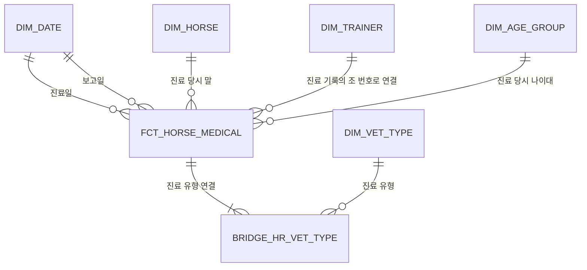

# mlo-03-p2-team3

원천 데이터 → Bronze → Silver → 품질 관리 → Gold → AI Ready Data

## 디렉토리 구조

```
.
├── data/
│   ├── 00_origin/   # 원천 데이터 (읽기 전용, 수정·이동·덮어쓰기 금지)
│   ├── 01_bronze/   # 원천 → Parquet (어느 파일을 언제 가져왔는지 기록)
│   ├── 02_silver/   # 컬럼명·날짜·데이터 타입·논리값 표준화
│   └── 03_gold/     # 스타 스키마 (fact / dim)
├── src/             # 파이썬 코드 (단계별 처리 + 검증)
├── docs/            # AS-IS 문제 정리, 품질 관리 보고서
├── meta/            # 메타데이터 (데이터 사전, 데이터 설명서, 변경 내역)
└── AGENTS.md        # AI 에이전트·팀원 작업 규칙
```

- `main`의 `data/`에는 팀 공용 원천 파일과 폴더 구조를 공유합니다. Bronze·Silver·Gold 처리는 각자의 작업 브랜치에서 진행합니다.

## 공용 원천의 Bronze·Silver 처리

`feat/fct-horse-medical`에서 공용 원천 12개를 Bronze Parquet 12개로 적재하고, 팀 공용 매핑 규칙에 맞춰 Silver 14개 테이블로 표준화합니다. 경주 매출 합계와 진료 유형 브리지는 별도 테이블로 생성합니다.

```powershell
python -m pip install -r requirements.txt
python src/01_bronze.py
python src/01_bronze_check.py
python src/02_normalize.py
python src/02_normalize_check.py
```

[전체 원천 AS-IS 프로파일링](docs/AS-IS.md) · [팀 공용 매핑 규칙](meta/mapping_rules.md) · [파일별 입출력과 검증 기록](meta/README.md)

## 진료 이력 데이터

원천은 `data/00_origin/horse/HR_VET_HIST.csv`이며, 진료 이력 1,488행과 6개 컬럼으로 구성됩니다.

### 원천 데이터 프로파일링

| 확인 항목 | 결과 |
|---|---|
| 날짜 형식 | 진료일은 `YYYY.MM.DD`, 보고일은 `YYYYMMDD` |
| 조 번호 | 앞자리에 `0`이 있는 값이 667행에 있어 문자열로 보존 |
| 복수 진료명 | 176행에 쉼표로 구분된 진료명이 포함됨 |
| 결측·완전 중복·날짜 파싱 실패 | 각각 0건 |

### Bronze·Silver 검증 결과

| 단계 | 산출물 | 검증 결과 |
|---|---|---|
| Bronze | `HR_VET_HIST.parquet`, `bronze_load_log.csv` | 1,488행. 원천 6개 컬럼의 이름·순서·값을 보존하고 추적용 컬럼 4개를 추가 |
| Silver 진료 이력 | `HR_VET_HIST.parquet` | 1,488행. 표준 컬럼 7개와 원천 행 번호 `_SRC_ROW_NO`를 저장 |
| Silver 진료 유형 브리지 | `HR_VET_TYPE_BRIDGE.parquet` | 1,664행. 표준 컬럼 2개와 `_SRC_ROW_NO`를 저장하고 `VET_SEQ`로 진료 이력에 연결 |

[AS-IS 상세 프로파일링](docs/HR_VET_HIST_AS_IS.md) · [파일별 입출력과 컬럼 매핑](meta/HR_VET_HIST_DATA_DICTIONARY.md)

## 진료 Gold 스타 스키마

`FCT_HORSE_MEDICAL`의 한 행은 **진료 기록 1건**입니다. `VET_SEQ`를 기본키로 두고 `VET_CNT=1`을 합산해 진료 건수를 계산합니다. 진료일과 보고일은 같은 날짜 차원에 각각 연결합니다. 유형별 건수는 `BRIDGE_HR_VET_TYPE`를 통해 집계합니다. 여러 유형이 붙는 기록이 있으므로, 전체 기록 건수는 Fact에서 집계합니다.



### 현재 작업 브랜치의 초안

```powershell
python src/04_gold_horse_medical.py
```

이 명령은 `data/03_gold/horse_medical_draft/`에 Fact 1,488행, 브리지 1,662행, 진료 유형 53종을 생성하는 용도입니다. 기존 로컬 초안의 Parquet는 이전 `DIM_TR_GRP` 형식으로 검증된 결과입니다.

수정된 코드는 경주 Gold와 동일하게 성별·등급·나이·조·조교사·외부마 여부·마주가 바뀔 때 말 차원 버전을 나눕니다. 버전은 스냅샷 다음 날부터 유효합니다. 진료일에 유효한 버전의 `HR_AGE`를 2~3세, 4~5세, 6~7세, 8세 이상으로 분류합니다. 조교사 키는 말 스냅샷의 조가 아닌 진료 이력의 `TR_GRP_NO`로 `DIM_TRAINER`에서 찾습니다. 이전 스냅샷이 없는 71건은 미확인 말·나이대 키로 보존합니다.

### 팀 버전으로 Gold 생성

Gold는 팀에서 확정한 `data/02_silver/clean/` 버전으로 생성합니다(D-012). 경주 브랜치 `feat/fct-race-entry` 커밋 `6315064`의 공통 차원 후보를 대조한 결과, `DIM_TRAINER`는 진료 이력의 모든 조 번호를 포함합니다. 해당 버전을 공통으로 쓰려면 아래 세 항목을 먼저 맞춥니다(D-010).

- `DIM_DATE` 범위를 진료·보고 기간인 2026-05-16~2026-11-18까지 포함하도록 확장합니다. 경주용 날짜 차원에서 진료·보고에 쓰인 날짜 5개가 빠져 있습니다.
- `DIM_HORSE`에 이전 스냅샷이 없는 진료 71건을 연결할 미확인 행을 합의합니다. 현재 코드는 키 `0`을 사용합니다.
- `DIM_AGE_GROUP`의 구간, 키, 미확인 행을 확정합니다. 경주 브랜치는 현재 `DIM_HORSE.AGE_BAND_NM`을 사용합니다.

공통 차원이 준비되면 아래 명령으로 `data/03_gold/horse_medical/`에 생성합니다.

```powershell
python src/04_gold_horse_medical.py --common-dims "공통차원폴더" --clean-version "팀에서확정한_CLEAN_VERSION"
```

| 공통 차원 파일 | 연결에 필요한 컬럼 |
|---|---|
| `DIM_DATE.parquet` | `DATE_KEY`, `FULL_DT` |
| `DIM_HORSE.parquet` | `HORSE_KEY`, `HR_NM`, `HR_AGE`, `VALID_FROM_DT`, `VALID_TO_DT` |
| `DIM_TRAINER.parquet` | `TRAINER_KEY`, `TR_GRP_NO` |
| `DIM_AGE_GROUP.parquet` | `AGE_GROUP_KEY`, `MIN_AGE`, `MAX_AGE` |

공통 차원으로 생성한 결과에는 입력 `CLEAN_VERSION`과 차원 파일 해시를 기록합니다. 기본키 중복과 외래키 검증의 근거는 AGENTS.md 7번입니다.
