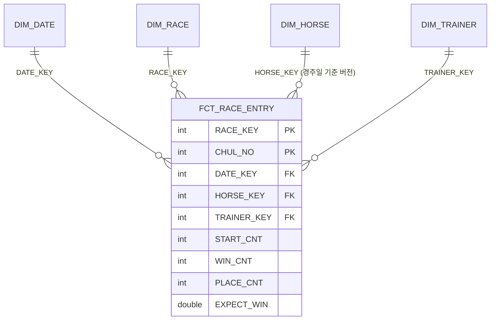
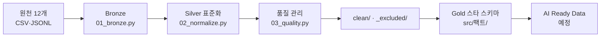

# mlo-03-p2-team3

원천 데이터 → Bronze → Silver → 품질 관리 → Gold → AI Ready Data

> **초안입니다.** 끝난 단계까지만 채웠고, 진행 중인 부분은 `진행 중`·`예정`으로 표시했습니다.
> 단계별 코드와 문서는 `develop` 브랜치에 있습니다. 아래 문서 링크는 `develop` 브랜치를 가리킵니다.

## 1. 팀 소개

- **팀명:** (작성 예정)

| 이름 | GitHub | 담당 팩트 (Gold) |
|:--|:--|:--|
| 원주 | [@wonju0516](https://github.com/wonju0516) | 경주 출전 `FCT_RACE_ENTRY` |
| 세은 | [@wlstpdms](https://github.com/wlstpdms) | 말 진료 `FCT_HORSE_MEDICAL` |
| 희정 | [@gmlwjd0055](https://github.com/gmlwjd0055) | 경주 매출 `FACT_ACTUAL_RACE_SALES` |
| 은빈 | [@eunbinko](https://github.com/eunbinko) | 배팅 취소 `FCT_BET_SELECTION_CANCEL_50S` |

## 2. 프로젝트 개요

### 프로젝트명
경마 운영 데이터 AI Ready Data 파이프라인 (가칭)

### 프로젝트 소개
- **주제:** 제주 경마(2026-05-22 ~ 2026-11-14, 경주 386개) 운영 데이터
- **원천:** 6개 시스템, 12개 파일

| 원천 시스템 | 파일 | 내용 |
|:--|:--|:--|
| 발매 (bet) | `bet_order.csv`, `bet_ticket.csv` | 전표 27,907건, 마권 523,416건 |
| 회원 (mbr) | `MBR_MASTER.csv` | 회원 4,383명 |
| 말 관리 (hms) | `HR_WEEKLY_SNAPSHOT.csv`, `TR_WEEKLY_SNAPSHOT.csv` | 말·조교사 주간 스냅샷 |
| 경주 운영 (rms) | `RC_RACE.csv`, `RC_ENTRY.csv`, `RC_ODDS.csv`, `RC_RESULT.csv`, `RC_SALES.csv` | 경주, 출전표, 배당, 결과, 매출 |
| 수의 진료 (vms) | `HR_VET_HIST.csv` | 진료 이력 1,488건 |
| 변경 이벤트 (mongodb) | `race_change_events.jsonl` | 말 취소·기수 변경 149건 |

- **하는 일:** 형식과 품질이 제각각인 원천을 **Bronze(원본 보존) → Silver(표준화·품질 관리) → Gold(스타 스키마) → AI Ready Data** 순서로 가공합니다. 단계마다 앞 단계와 숫자를 맞춰 보는 검증(대사)을 합니다.

### 프로젝트 필요성 (AS-IS)
원천 데이터에는 아래 문제가 있습니다. 자세한 내용은 [`docs/AS-IS.md`](https://github.com/encore-ai-campus/mlo-03-p2-team3/blob/develop/docs/AS-IS.md)에 있습니다.

| 문제 | 예 |
|:--|:--|
| 이름이 제각각 | `member_no` / `MBR_NO`, 같은 `ticket_cnt`가 파일마다 다른 뜻 |
| 날짜 형식이 섞임 | 회원 생일 `YYYYMMDD` / `YYYY-MM-DD` / `YYYY.MM.DD` / 빈칸 |
| 코드값 불일치 | 승식 영문·한글 혼용(`WIN` / `단승`), 상태값 대소문자 혼용 |
| 한 칸에 여러 값 | 마체중 `279+14`, 날씨·주로 `날씨: 흐림 주로: 다습 (14%)`, 진료명 `정치,낭치` |
| 단위·표기 혼용 | 상금 `만원`, 도입가 `천원`, 매출 쉼표 문자열 |
| 의미가 다른 값이 같은 칸에 | 순위 칸에 `94`(경주제외)·`95`(출주취소), 조교사 칸에 `외부마` |
| 중복·불일치 | 마권 완전 중복 1,052행, 전표 헤더와 마권 합계 불일치 93건 |

### 프로젝트 목표
- AI가 바로 쓸 수 있는 **정확하고, 추적 가능하고, 재현 가능한** 데이터를 만듭니다.
  - **정확:** 표준 코드·타입으로 통일하고, 품질 문제를 규칙과 근거(결정 ID)로 처리
  - **추적:** 모든 행이 원천 파일과 행 번호(`_SRC_ROW_NO`)로 거슬러 올라감
  - **재현:** 다시 실행해도 같은 결과 (정렬 고정, 실행 시각을 본문에 넣지 않음)
- 데이터의 양보다 **얼마나 더러운 데이터를 얼마나 깔끔하게 만들었는지**가 핵심입니다.

## 3. 기술 스택

| 구분 | 기술 스택 |
|:---:|:---|
| **언어** |  |
| **데이터 처리** |   |
| **저장 형식** |    |
| **협업** |   (Pull Request 리뷰 후 `develop`에 병합) |
| **AI 도구** |   |


## 4. WBS

2026-11-20(금) 커밋 기록 기준입니다.

| 시간 | 작업 | 담당 |
|:--|:--|:--|
| 09:40 ~ 11:49 | 저장소 생성, 디렉토리 구조 | 세은, 원주 |
| 12:54 ~ 14:11 | 팀 공용 원천 데이터·대사 규칙 공유 | 세은 |
| 14:33 ~ 15:54 | 원천 → Bronze → Silver 표준화 (각자) | 전원 |
| 15:14 | 데이터 안내서, 컬럼 사전 | 원주 |
| 16:36 ~ 17:34 | 품질 관리, Gold 스타 스키마 (각자), AS-IS 정리 | 전원 |
| 17:46 ~ 18:01 | 공용 Bronze·Silver `develop` 병합 (PR #1, #2) | 원주 |
| 18:09 ~ 19:57 | 공용 품질 관리 통합 (PR #3 ~ #6) | 희정, 세은, 원주 |
| 11-23 | Gold 경주 출전 `develop` 병합 (PR #8) | 원주 |
| 진행 중 | Gold 나머지 3개 병합, 공통 차원 통합 | 세은, 희정, 은빈 |
| 예정 | AI Ready Data, `develop` → `main` | 전원 |

## 5. 요구사항 명세서

| 단계 | 해야 하는 일 | 상태 |
|:--|:--|:--|
| Bronze | 원천 12개를 값 그대로 Parquet로 저장. 출처(`_SRC_SYSTEM`, `_LOAD_FILE`, `_LOAD_DTM`, `_SRC_ROW_NO`) 기록. 원천 행 수 = Bronze 행 수 | 완료 |
| 표준화 | 컬럼명 UPPER_SNAKE, 날짜·시각·숫자 타입 변환, 코드값 통일, 한 칸 여러 값 분리. 행은 지우지 않음. 바뀐 내용은 데이터 사전, NULL이 된 원천값은 이슈 로그에 기록 | 완료 |
| 품질 검증 | 품질 규칙 26개(유일성·완전성·유효성·일관성·참조 무결성·시점). 규칙마다 근거 결정 ID(D-001 ~ D-012) | 완료 |
| Silver | 표준화 결과는 그대로 두고, 품질 처리 결과를 `clean/`(유지 행 + 표시 컬럼)과 `_excluded/`(제외 행)로 나눠 저장. 표준화 행 수 = clean + 제외 | 완료 |
| Gold | 팀원마다 스타 스키마 1개. `clean/`만 입력. PK 중복 0, 팩트 키가 모두 차원에 있어야 함. 겹치는 차원은 공통 차원으로 통합 | 진행 중 (1/4) |
| AI Ready Data | (작성 예정) | 예정 |

## 6. ERD

### 경주 출전 `FCT_RACE_ENTRY` (원주)



- **그레인 (한 행의 의미):** 경주별 출전마 1두 (`RC_DT` + `RC_NO` + `CHUL_NO`). 출전표 1행 = 팩트 1행, 3,666행
- **측정값**

| 측정값 | 계산 |
|:--|:--|
| `START_CNT` | 실제로 뛰었으면 1, 경주제외(94)·출주취소(95)면 0 (`RC_RESULT`) |
| `WIN_CNT` | 착순 1이면 1 (`RC_RESULT`) |
| `PLACE_CNT` | 착순 3 이하면 1 (`RC_RESULT`) |
| `EXPECT_WIN` | 경주 안에서 (1 / 단승 배당) ÷ Σ(1 / 단승 배당). 뛰지 않은 말은 0 (`RC_ODDS`) |

- `DIM_HORSE`는 SCD2입니다. 경주일 **이전** 가장 최근 스냅샷의 말 속성을 씁니다.
- 자세한 내용: [`docs/gold/race_entry.md`](https://github.com/encore-ai-campus/mlo-03-p2-team3/blob/develop/docs/gold/race_entry.md)

### 말 진료 `FCT_HORSE_MEDICAL` (세은) — 진행 중
### 경주 매출 `FACT_ACTUAL_RACE_SALES` (희정) — 진행 중
### 배팅 취소 `FCT_BET_SELECTION_CANCEL_50S` (은빈) — 진행 중

### 공통 차원 — 진행 중
`DIM_DATE`, `DIM_HORSE`, `DIM_RACE`, `DIM_TRAINER`, `DIM_MEMBER`, `DIM_CHANNEL`은 여러 팩트가 함께 씁니다. Gold 4개가 모두 병합되면 하나로 통합합니다. 안건: [`docs/gold/COMMON_DIMENSIONS.md`](https://github.com/encore-ai-campus/mlo-03-p2-team3/blob/develop/docs/gold/COMMON_DIMENSIONS.md)

## 7. 주요 프로시저



| 단계 | 실행 | 검증 | 검증 내용 |
|:--|:--|:--|:--|
| Bronze | `src/01_bronze.py` | `src/01_bronze_check.py` | 원천 행 수 = Bronze 행 수, 값 그대로 적재, 원천 파일 해시 |
| Silver 표준화 | `src/02_normalize.py` | `src/02_normalize_check.py` | Bronze 행 1:1 보존, 변환 실패·코드표 밖 값 0건, NULL 기대 건수, NULL이 된 원천값이 모두 이슈 로그에 있는지 |
| 품질 관리 | `src/03_quality.py` | `src/03_quality_check.py` | 표준화 = clean + 제외, 플래그 건수 = 팀 기준, 처리 코드 없이 다시 계산해 행 단위 일치, 모든 규칙에 결정 ID |
| Gold | `src/<팩트>/04_*.py` | `src/<팩트>/04_*_check.py` | PK 중복 0, 팩트 키가 모두 차원에 있음, 측정값을 clean에서 다시 계산해 일치 |
| 공통 | — | 두 번 실행 | 결과 파일 해시가 같은지 (재현성) |

```bash
python -m venv .venv && .venv/bin/pip install -r requirements.txt
.venv/bin/python src/01_bronze.py && .venv/bin/python src/01_bronze_check.py
.venv/bin/python src/02_normalize.py && .venv/bin/python src/02_normalize_check.py
.venv/bin/python src/03_quality.py && .venv/bin/python src/03_quality_check.py
.venv/bin/python src/race_entry/04_fct_race_entry.py && .venv/bin/python src/race_entry/04_fct_race_entry_check.py
```

## 8. 수행 결과

### 행 수 대사

| 원천 | 원천 | Bronze | Silver 표준화 | clean | 제외 |
|:--|--:|--:|--:|--:|--:|
| bet_ticket | 523,416 | 523,416 | 523,416 | 522,364 | 1,052 (완전 중복) |
| bet_order | 27,907 | 27,907 | 27,907 | 27,907 | 0 |
| MBR_MASTER | 4,383 | 4,383 | 4,383 | 4,383 | 0 |
| HR_WEEKLY_SNAPSHOT | 52,642 | 52,642 | 52,642 | 52,642 | 0 |
| RC_ENTRY / RC_ODDS / RC_RESULT | 3,666 | 3,666 | 3,666 | 3,666 | 0 |
| RC_SALES | 3,088 | 3,088 | 2,702 + 합계 386 | 2,702 + 386 | 0 |
| HR_VET_HIST | 1,488 | 1,488 | 1,488 (진료명 브리지 1,664) | 1,488 (브리지 1,662) | 0 |

### 단계별 전후 비교 (예)

| 항목 | 원천 (Bronze) | Silver |
|:--|:--|:--|
| 회원 생일 | `19571206`, `1957-10-25`, `1951.06.03` | `1957-12-06`, `1957-10-25`, `1951-06-03` (DATE) |
| 승식 | `WIN`, `PLC`, `QNL`, `단승`, `연승`, `복승` | `WIN`, `PLC`, `QNL` |
| 마체중 | `279+14` | 체중 279, 증감 14 (kg) |
| 날씨·주로 | `날씨: 흐림  주로: 다습  (14%)` | 날씨 `CLOUDY`, 주로 `MOIST`, 함수율 14 |
| 상금 | `순위상금: 700만원 322만원 210만원 98만원 70만원` | 1~5위 7,000,000 / 3,220,000 / 2,100,000 / 980,000 / 700,000 (원) |

### 품질 관리 결과 (팀 기준 숫자와 일치)

| 항목 | 건수 | 처리 |
|:--|--:|:--|
| 마권 완전 중복 (D-002) | 1,052 | 제외 (`_excluded/`) |
| 0원 마권 (D-003) | 3,632 | 표시 `INVALID_YN` |
| 늦은 취소 마권 / 전표 (D-004) | 1,000 / 546 | 표시 `LATE_CANCEL_YN` |
| 빈 마명 보정 (D-005) | 1,560 | 출전표 마명으로 보정, `HR_NM_FILLED_YN` |
| 전표 헤더 불일치 / 원전표 없는 취소 (D-006) | 93 / 644 | 표시 |
| 진료 조 불일치 / 이전 스냅샷 없음 (D-007) | 11 / 71 | 표시 |

### Gold 결과 (경주 출전)
- 팩트 3,666행, 출주 3,644 / 1착 386 / 3착 안 1,158, 우승률 10.59%
- PK 중복 0, 팩트 키 모두 차원에 있음, 검증 통과

자세한 보고서: [`docs/품질관리.md`](https://github.com/encore-ai-campus/mlo-03-p2-team3/blob/develop/docs/품질관리.md), [`docs/DATA_GUIDE.md`](https://github.com/encore-ai-campus/mlo-03-p2-team3/blob/develop/docs/DATA_GUIDE.md)

## 9. 한 줄 회고

| 이름 | 회고 |
|:--|:--|
| 원주 | (작성 예정) |
| 세은 | (작성 예정) |
| 희정 | (작성 예정) |
| 은빈 | (작성 예정) |

---

## 디렉토리 구조

```
.
├── data/
│   ├── 00_origin/   # 원천 데이터 (읽기 전용, 수정·이동·덮어쓰기 금지)
│   ├── 01_bronze/   # 원천 → Parquet (어느 파일을 언제 가져왔는지 기록)
│   ├── 02_silver/   # 컬럼명·날짜·데이터 타입·논리값 표준화
│   │   ├── clean/      # 품질 관리 후 유지 행 + 표시 컬럼 → Gold의 입력
│   │   └── _excluded/  # 품질 관리에서 제외한 행
│   └── 03_gold/     # 스타 스키마 (팩트별 폴더)
├── src/             # 파이썬 코드 (단계별 처리 + 검증)
├── docs/            # AS-IS 문제 정리, 단계별 기록, 품질 관리 보고서
├── meta/            # 메타데이터 (데이터 사전, 결정 로그, 처리 로그)
└── AGENTS.md        # AI 에이전트·팀원 작업 규칙
```

- `main`의 `data/`에는 팀 공용 원천 파일과 폴더 구조를 공유합니다. 단계별 산출물은 `develop`에서 병합한 뒤 `main`으로 올립니다.
