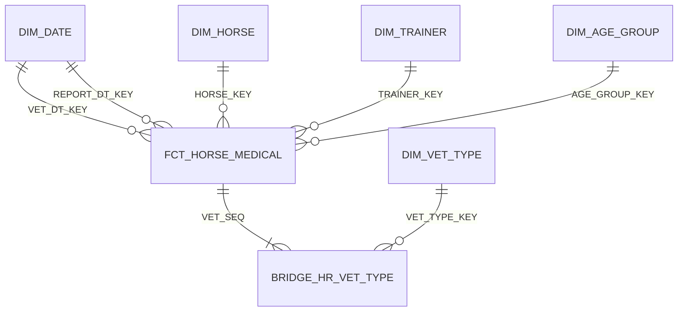

# Gold 말 진료 스타 스키마

## 1. 개요

2026년 제주경마 경주마의 진료기록을 기반으로 연령대별 진료 현황, 진료 유형 및 반복 진료기록을 분석하기 위한 Gold 스타 스키마를 구축함.

- **입력 데이터:** `data/02_silver/clean/` 진료 데이터(D-012)
- **공통 차원:** `data/03_gold/common/` 날짜·말·조교사 차원(D-013~D-015)
- **출력 경로:** `data/03_gold/horse_medical/`
- **그레인:** 경주마 1마리의 진료기록 1건

## 2. 진료 Gold 테이블 구성

진료 Gold는 **팩트 1개, 브리지 1개, 전용 차원 2개, 공통 차원 3개로 총 7개 테이블**로 구성함.

| 구분 | 테이블명 | 한 행의 의미 | 주요 키 |
|---|---|---|---|
| **팩트** | `FCT_HORSE_MEDICAL` | 경주마 1마리의 진료기록 1건 | `VET_SEQ`, `VET_DT_KEY`, `REPORT_DT_KEY`, `HORSE_KEY`, `TRAINER_KEY`, `AGE_GROUP_KEY` |
| **브리지** | `BRIDGE_HR_VET_TYPE` | 진료기록 1건과 진료유형 1개의 연결 | `VET_SEQ`, `VET_TYPE_KEY` |
| **전용 차원** | `DIM_AGE_GROUP` | 연령 구간 1개 (2~3세, 4~5세 등) | `AGE_GROUP_KEY` |
| **전용 차원** | `DIM_VET_TYPE` | 표준화된 진료유형 1개 | `VET_TYPE_KEY` |
| **공통 차원** | `DIM_DATE` | 날짜 1일 | `DATE_KEY` |
| **공통 차원** | `DIM_HORSE` | 경주마의 유효기간별 정보 버전 1건 | `HORSE_KEY` |
| **공통 차원** | `DIM_TRAINER` | 조교사 정보 1건 | `TRAINER_KEY` |

## 3. 주요 설계 특징

- **진료일·보고일 분리:** `VET_DT_KEY`와 `REPORT_DT_KEY`를 통해 공통 `DIM_DATE`에 각각 연결함.
- **말 정보 연결:** 마명과 진료일을 기준으로 연결하며, 스냅샷 다음 날부터 해당 말 정보 버전이 유효함. 이전 스냅샷이 없는 경우 `HORSE_KEY = 0`으로 처리함.
- **조교사 연결:** 진료기록의 `TR_GRP_NO`를 기준으로 `TRAINER_KEY`를 연결함.
- **연령군 분류:** 진료일에 유효한 말 정보 버전의 `HR_AGE`를 사용하며, 미확인 연령군은 `AGE_GROUP_KEY = 0`으로 관리함.
- **복수 진료유형 관리:** `BRIDGE_HR_VET_TYPE`으로 진료기록과 진료유형의 다대다 관계를 처리함.
- **진료기록 건수:** 전체 진료 건수는 `FCT_HORSE_MEDICAL`의 `SUM(VET_CNT)`로 계산함. 유형별 분석 시 `VET_SEQ` 중복을 제거하여 집계함.
- **품질 검증:** `_manifest.json`에 입력 버전, 행 수, 제외 건수 및 PK·FK 검증 결과를 기록함.

## 4. ERD



## 5. 생성 및 검증

저장소 루트에서 다음 명령어를 실행함.

```powershell
python -X utf8 src/horse_medical/04_gold_horse_medical.py
python -X utf8 src/horse_medical/04_gold_horse_medical.py --check
python -X utf8 src/common/04_common_dims_check.py
```

`--check`는 Silver clean 데이터와 공통 차원을 기준으로 계산한 결과를 저장된 Gold 테이블 및 매니페스트와 비교하여 검증함.

### 5.1 데이터 검증 결과

| 검증 항목 | 결과 |
|---|---:|
| Clean 진료 행 수 = Gold 팩트 행 수 = `SUM(VET_CNT)` | 1,488 |
| Clean 유형 연결 수 = Gold 브리지 행 수 | 1,662 |
| 이전 말 스냅샷 없는 기록 = 미확인 말 기록 | 71 |
| Gold 입력 제외 행 | 0 |
| PK 중복 | 0 |
| 미해결 FK | 0 |
| Parquet 4개 및 매니페스트 SHA-256 재현성 검증 | 5개 모두 일치 |

### 5.2 검증 매니페스트

**파일:** `data/03_gold/horse_medical/_manifest.json`

다음 정보를 기록함.

- 입력 데이터의 `CLEAN_VERSION`
- 참조한 공통 차원 파일의 SHA-256
- 테이블별 행 수 및 제외 건수
- PK·FK 무결성 검증 결과
- 2회 생성 결과의 SHA-256 일치 여부

## 6. AI Ready Data 활용

생성된 진료 Gold 테이블은 경주마의 입상 여부 예측을 위한 AI Ready Data의 입력 데이터로 활용함.

| 피처명 | 설명 |
|---|---|
| `VET_CNT_30D` | 경주일 이전 30일간 진료기록 건수 |
| `VET_CNT_90D` | 경주일 이전 90일간 진료기록 건수 |
| `LAMENESS_90D_YN` | 경주일 이전 90일간 파행 관련 진료기록 여부 |

모든 피처는 경주일 이전에 이용 가능한 정보만 사용하며, 경주 이후 진료기록은 포함하지 않음.
