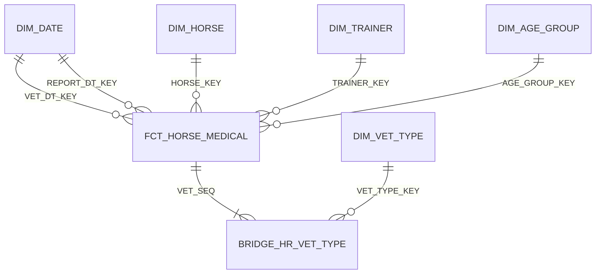

# Gold 말 진료 스타 스키마

입력은 `data/02_silver/clean/`의 진료 데이터(D-012)와 `data/03_gold/common/`의 날짜·말·조교사 차원(D-013~D-015)입니다. 진료 팩트, 유형 브리지, 나이대·진료 유형 차원을 `data/03_gold/horse_medical/`에 생성합니다. 차원 연결 조건은 [공통 차원 문서](common.md)에 있습니다.

## 설계

| 테이블 | 행 단위 및 키 | 위치 또는 입력 |
|---|---|---|
| `FCT_HORSE_MEDICAL` | 진료 기록 1건. PK는 `VET_SEQ`, 측정값 `VET_CNT`는 행마다 1 | `HR_VET_HIST` |
| `BRIDGE_HR_VET_TYPE` | 진료 기록과 진료 유형 연결 1건. 복합 PK는 `VET_SEQ`와 `VET_TYPE_KEY` | `HR_VET_TYPE_BRIDGE` |
| `DIM_DATE` | 날짜 1일. PK는 `DATE_KEY`(YYYYMMDD) | 공통 차원 |
| `DIM_HORSE` | 마명별 SCD2 버전 1건. PK는 `HORSE_KEY` | 공통 차원 |
| `DIM_TRAINER` | 조교사별 최신 스냅샷 1건. PK는 `TRAINER_KEY` | 공통 차원 |
| `DIM_AGE_GROUP` | 2~3세, 4~5세, 6~7세, 8세 이상, 미확인. PK는 `AGE_GROUP_KEY` | 코드에 정의한 구간 |
| `DIM_VET_TYPE` | 표준 진료 유형 1개. PK는 `VET_TYPE_KEY` | `HR_VET_TYPE_BRIDGE` |



- 진료일과 보고일을 공통 `DIM_DATE`에 각각 연결해 `VET_DT_KEY`, `REPORT_DT_KEY`를 붙입니다(D-014).
- 말은 마명과 진료일로 연결합니다. 스냅샷 다음 날부터 해당 버전이 유효하며, 진료일보다 앞선 스냅샷이 없으면 미확인 말 키 `0`으로 연결합니다(D-007, D-015). 나이대는 같은 말 버전의 `HR_AGE`를 사용하며 미확인 키는 `0`입니다.
- 조교사는 진료 기록의 `TR_GRP_NO`로 연결합니다.
- 전체 진료 건수는 팩트의 `SUM(VET_CNT)`로 계산합니다. 한 진료가 여러 유형에 속할 수 있으므로 유형을 넘나드는 건수는 `VET_SEQ`를 중복 제거해 집계합니다.

## 생성 및 검증

저장소 루트에서 실행합니다.

```powershell
python -X utf8 src/horse_medical/04_gold_horse_medical.py
python -X utf8 src/horse_medical/04_gold_horse_medical.py --check
python -X utf8 src/common/04_common_dims_check.py
```

`--check`는 clean과 공통 차원으로 계산한 결과를 저장된 Gold 테이블 및 매니페스트와 대조합니다. [Gold 매니페스트](../../data/03_gold/horse_medical/_manifest.json)에 입력 `CLEAN_VERSION`, 참조한 공통 차원 파일의 SHA-256, 테이블별 행 수, 제외 건수와 키 검증 결과를 기록합니다.

| 대사·검증 항목 | 결과 |
|---|---:|
| clean 진료 행 수 = Gold 팩트 행 수 = `SUM(VET_CNT)` | 1,488 |
| clean 유형 연결 수 = Gold 브리지 행 수 | 1,662 |
| 이전 말 스냅샷 없는 clean 기록 = Gold 미확인 말 기록 | 71 |
| Gold 입력 제외 행 | 0 |
| PK 중복 및 미해결 FK | 각각 0 |
| 2회 생성한 Parquet 4개와 매니페스트의 SHA-256 | 5개 모두 일치 |
