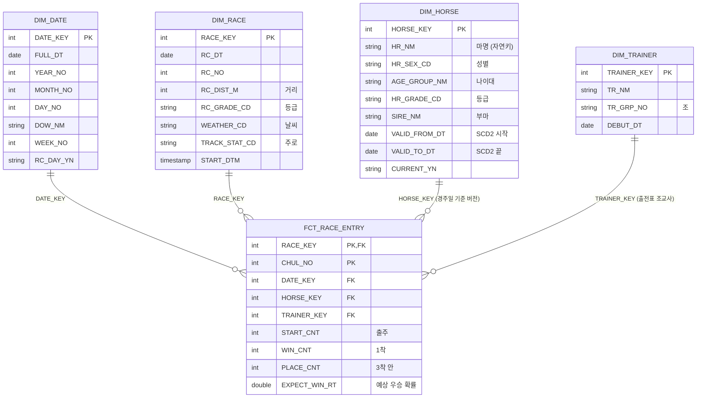

# Gold 단계 기록: 경주 출전 스타 스키마

- **코드:** `src/race_entry/04_fct_race_entry.py` (생성), `src/race_entry/04_fct_race_entry_check.py` (검증)
- **입력:** `data/02_silver/clean/` (품질 관리까지 끝난 결과, D-012). 표준화 결과로는 만들지 않습니다
- **출력:** `data/03_gold/race_entry/FCT_RACE_ENTRY.parquet` (팩트). 차원 4개는 공통 차원 `data/03_gold/common/`을 씁니다 (`docs/gold/common.md`, D-013 ~ D-016)

## 1. 설계

| 항목 | 내용 |
|:--|:--|
| 업무 프로세스 | 경주 출전 |
| 팩트 그레인 | **경주별 출전마 1두** (`RC_DT` + `RC_NO` + `CHUL_NO`). 출전표 1행 = 팩트 1행 (3,666행) |
| 측정값 | `START_CNT` 출주, `WIN_CNT` 1착, `PLACE_CNT` 3착 안, `EXPECT_WIN_RT` 배당 기반 예상 우승 확률 |
| 보고 싶은 것 | 조교사별 / 말 성별·나이대·등급·부마별 / 경주 거리·주로·날씨별 우승률·입상률 |
| 원천 (clean) | RC_ENTRY, RC_RESULT, RC_ODDS, RC_RACE, HR_WEEKLY_SNAPSHOT, TR_WEEKLY_SNAPSHOT |

**출전(3,666)과 출주(3,644)를 구분하는 이유**
- 그레인은 출전표에 오른 말 전부입니다. 경주제외 18두와 출주취소 4두도 행으로 남깁니다.
- 실제로 뛴 말은 `START_CNT = 1`로 구분하고, 우승률의 분모로 씁니다.



GitHub에서 열면 위 코드가 그림으로 보입니다. 행 수는 FCT_RACE_ENTRY 3,666 / DIM_DATE 177 / DIM_RACE 386 / DIM_HORSE 4,126 / DIM_TRAINER 18입니다. 그림에는 주요 컬럼만 넣었고, 전체 컬럼은 3장에 있습니다.

**SCD2로 말 버전을 고르는 방식 (예: '가문의여신')**

| HORSE_KEY | 조교사 | 스냅샷 | VALID_FROM_DT | VALID_TO_DT |
|--:|:--|:--|:--|:--|
| 2 | (외부마) | 2026-05-20 | 2026-05-21 | 2026-05-27 |
| 3 | 김길홍 | 2026-05-27 | 2026-05-28 | 2026-09-23 |
| 4 | (외부마) | 2026-09-23 | 2026-09-24 | 9999-12-31 |

이 말이 2026-06-05에 출전했다면, 경주일이 2번째 버전 기간 안에 들어가므로 팩트의 `HORSE_KEY`는 3이 됩니다. 스냅샷 날짜와 경주일이 같으면 그 스냅샷은 쓰지 않습니다(유효 기간이 다음 날부터 시작하므로).

## 2. 데이터만 봐서는 모르는 규칙 (요청서)

| # | 규칙 | 구현 |
|:-:|:--|:--|
| 1 | 착순 94 = 경주제외, 95 = 출주취소 → 순위 아님, `START_CNT = 0` | `ENTRY_STAT_CD`가 RAN일 때만 1. 이 22두는 `WIN_CNT`·`PLACE_CNT`·`EXPECT_WIN_RT`도 0 |
| 2 | 말 ID가 없어 마명(`HR_NM`)으로 연결 | 마명이 자연키입니다. 같은 이름이면 생일·부마·모마가 모든 스냅샷에서 같은 것을 확인했습니다 |
| 3 | 말 등급·속성은 경주일 **이전** 가장 최근 스냅샷 기준, DIM_HORSE는 SCD2 | `VALID_FROM_DT` = 스냅샷 다음 날. 스냅샷 날짜와 경주일이 같은 날이면 그 스냅샷은 쓰지 않습니다(엄격히 이전) |
| 4 | 팩트에는 키 + 측정값만. 설명 속성은 차원, 승률은 마트에서 계산 | 팩트 컬럼은 키 5개 + 측정값 4개. 비율은 저장하지 않고, 마트는 만들지 않기로 했습니다 (4장의 조회 예시 참고) |
| 5 | 기대값: SUM(START_CNT) = 3,644, SUM(WIN_CNT) ≈ 386, 우승률 약 10.6% | 3,644 / 386 / 10.59% (검증 통과) |

## 3. 테이블과 컬럼

대리키는 모두 **자연키로 정렬한 순번(1부터)**이라 재실행해도 같습니다.

### FCT_RACE_ENTRY (3,666행)

| 컬럼 | 종류 | 뜻 |
|:--|:--|:--|
| `RACE_KEY` | PK·FK → DIM_RACE | 경주 |
| `CHUL_NO` | PK (degenerate) | 마번. 그레인의 일부 |
| `DATE_KEY` | FK → DIM_DATE | 경주일 (YYYYMMDD) |
| `HORSE_KEY` | FK → DIM_HORSE | **경주일 기준 말 버전** (SCD2) |
| `TRAINER_KEY` | FK → DIM_TRAINER | **출전표의 조교사** (경주 당시) |
| `START_CNT` | 측정값 | 출주 1 / 경주제외·출주취소 0 |
| `WIN_CNT` | 측정값 | 착순 1이면 1 |
| `PLACE_CNT` | 측정값 | 착순 3 이하면 1 |
| `EXPECT_WIN_RT` | 측정값 | 경주 안에서 (1 / 단승 배당) ÷ Σ(1 / 단승 배당). 경주마다 합이 1, 뛰지 않은 말은 0 |

- 조교사를 말 차원이 아니라 출전표에서 연결하는 이유: 말 스냅샷의 조교사 칸은 외부마와 소속 사이를 자주 오갑니다. 지금 데이터에서는 두 값이 0건 차이로 같지만, 기준은 경주 당시 출전표로 정했습니다.
- `EXPECT_WIN_RT`을 정규화한 이유: 1/배당을 그대로 더하면 공제금 때문에 경주당 합이 약 1.25가 되어 실제 우승 수와 비교할 수 없습니다.

### DIM_HORSE (공통 차원, 4,126행 + 미상 1행, SCD2)

| 컬럼 | 뜻 |
|:--|:--|
| `HORSE_KEY` | 대리키 (버전마다 하나) |
| `HR_NM` | 마명 (자연키) |
| `HR_SEX_CD`, `HR_AGE`, `AGE_GROUP_NM`, `HR_GRADE_CD` | 성별, 나이, 나이대(2~3세 / 4~5세 / 6~7세 / 8세 이상), 등급 |
| `TR_GRP_NO`, `TR_NM`, `TR_EXTERNAL_YN`, `OW_NM` | 스냅샷 기준 소속 조, 조교사, 외부마 여부, 마주 |
| `HR_BIRTH_DT`, `SIRE_NM`, `DAM_NM` | 생일, 부마, 모마 (변하지 않는 값) |
| `SRC_SNAPSHOT_DT` | 이 버전이 시작된 스냅샷 날짜 |
| `VALID_FROM_DT`, `VALID_TO_DT` | 유효 기간. 시작 = 스냅샷 다음 날, 끝 = 다음 버전 시작 전날, 현재 버전은 9999-12-31 |
| `CURRENT_YN` | 현재 버전 여부 |

- **새 버전을 만드는 기준:** 성별, 등급, 나이, 소속 조, 조교사, 외부마 여부, 마주 중 하나라도 바뀌면 새 버전을 만듭니다. 예: 거세(M→G) 32건, 등급 변경 480건
- **차원에 넣지 않은 것:** 레이팅과 통산·최근 1년 성적. 매주 바뀌어서 넣으면 버전이 약 22,000개가 됩니다.
- **규모:** 말 1,250두, 말당 버전 1~10개(평균 3.3개). 팩트가 쓰는 버전은 1,487개(출전마 833두)입니다.

### DIM_RACE (공통 차원, 386행 + 미상 1행)
- `RACE_KEY`와 경주 속성으로 구성됩니다.
  - 경주일, 경주번호, 경마장
  - 개최 일차, 거리(`RC_DIST_M`), 경주 등급, 부담 방식
  - 마종, 경주명, 날씨(`WEATHER_CD`), 주로 상태(`TRACK_STAT_CD`), 함수율
  - 1~5위 상금, 출발 시각
- 컬럼 뜻은 `docs/SILVER_COLUMNS.md`의 RC_RACE와 같습니다.

### DIM_TRAINER (공통 차원, 18행 + 미상 1행)
- `TRAINER_KEY`, `TR_NM`, `TR_GRP_NO`(소속 조), `TR_BIRTH_DT`, `DEBUT_DT`
- 값이 바뀌지 않아 Type 1입니다.

### DIM_DATE (공통 차원, 187행 + 미상 1행)
- 범위는 2026-05-16 ~ 2026-11-18의 연속 날짜이고(네 팩트가 참조하는 날짜 전체, D-014), 그중 경마일이 52일입니다. 이 팩트의 경주일은 2026-05-22 ~ 2026-11-14입니다.
- 컬럼: `DATE_KEY`(YYYYMMDD), `FULL_DT`, `YEAR_NO`, `MONTH_NO`, `DAY_NO`, `DOW_NO`(1 = 월), `DOW_NM`, `WEEK_NO`(ISO), `RC_DAY_YN`

## 4. 우승률·입상률 조회 방법 (비율은 조회할 때 계산)

```python
import pandas as pd
f = pd.read_parquet("data/03_gold/race_entry/FCT_RACE_ENTRY.parquet")
x = f.merge(pd.read_parquet("data/03_gold/common/DIM_HORSE.parquet"), on="HORSE_KEY")
a = x.groupby("AGE_GROUP_NM")[["START_CNT", "WIN_CNT", "PLACE_CNT", "EXPECT_WIN_RT"]].sum()
a["WIN_RT"] = a.WIN_CNT / a.START_CNT      # 우승률
a["PLACE_RT"] = a.PLACE_CNT / a.START_CNT  # 입상률
a["AE_RT"] = a.WIN_CNT / a.EXPECT_WIN_RT      # 실제 우승 ÷ 배당 기반 예상 우승
```

**실행 결과 예 (나이대별)**

| 나이대 | 출주 | 우승 | 입상 | 우승률 | 입상률 | 실제 ÷ 예상 |
|:--|--:|--:|--:|--:|--:|--:|
| 2~3세 | 1,103 | 173 | 428 | 15.7% | 38.8% | 1.04 |
| 4~5세 | 1,671 | 170 | 540 | 10.2% | 32.3% | 1.04 |
| 6~7세 | 513 | 24 | 112 | 4.7% | 21.8% | 0.67 |
| 8세 이상 | 357 | 19 | 78 | 5.3% | 21.8% | 0.92 |

**주의: 실제 ÷ 예상(A/E)은 출전마 단위 속성에서만 의미가 있습니다.**
- `EXPECT_WIN_RT`은 경주 안에서 합이 1이 되도록 만들었습니다.
- 그래서 거리·주로·날씨처럼 **경주 단위 속성**으로 묶으면 예상 우승 합이 그 묶음의 경주 수와 같아지고, 실제 우승 수와도 같아져서 A/E가 항상 1.0입니다.
- 예상 대비 비교는 말·조교사·성별·나이대·등급·부마처럼 **출전마 단위 속성**에서 쓰세요. 우승률·입상률은 어떤 속성으로 묶어도 의미가 있습니다.

## 5. 검증 결과 (`src/race_entry/04_fct_race_entry_check.py`)

| 점검 | 결과 |
|:--|:--|
| 테이블마다 PK 중복 0, 자연키 중복 0 | 팩트 + 공통 차원 4개 통과 |
| 팩트의 모든 키가 공통 차원에 있음 (DATE·RACE·HORSE·TRAINER) | 없는 키 0, 미상(0) 0 |
| 팩트 행 = 출전표 행 (1:1) | 3,666 = 3,666 |
| SUM(START_CNT) / SUM(WIN_CNT) / SUM(PLACE_CNT) | 3,644 / 386 / 1,158 |
| 우승률 | 10.59% |
| 측정값 행 단위 재계산 (clean 결과표·배당표) | 4개 측정값 모두 일치 |
| EXPECT_WIN_RT | 경주마다 합 1, 전체 합 386.000000, 뛰지 않은 말 0 |
| TRAINER_KEY = 출전표 조교사 | 일치 |
| SCD2: 기간이 겹치지 않고 빈틈 없음, 말마다 현재 버전 1개 | 통과 |
| 팩트의 말 버전 = 경주일 **이전** 최근 스냅샷 (독립 재계산) | 속성 불일치 0 |
| 팩트 컬럼 = 키 + 측정값만 | 통과 |
| 재실행 시 Gold 파일 해시 | 동일 |
| 공통 차원 전환 전후 팩트 | 바이트까지 동일 (키가 그대로라 측정값·키 변화 없음) |

## 6. 남은 것

- **공통 차원 통합 (D-010):** 완료. 차원 4개는 공통 차원(`data/03_gold/common/`)을 씁니다. 결정은 D-013 ~ D-016, 안건 기록은 `docs/gold/COMMON_DIMENSIONS.md`에 있습니다.
- **시점 주의 (AI-ready용):** `EXPECT_WIN_RT`은 최종 배당 기준이라 발매 마감 시점에야 알 수 있는 값입니다. 경주 결과 예측의 특성으로 쓸 때는 이 점을 명시해야 합니다.
