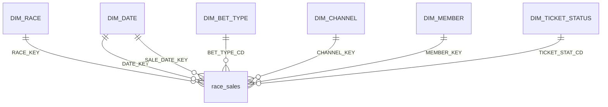

# race_sales: 마권 매출 Gold 스타 스키마

## 분석 목적과 범위

**경주·고객·채널·구매 시점에 따른 마권 매출 구성 및 구매 규모 분석**을 위한 스타 스키마입니다. 주 팩트는 `race_sales` 하나이며 차원은 6개입니다. 팩트 파일명은 `race_sales.parquet`이고, 마권 입력에 나타난 WIN·PLC·QNL 3개 승식을 대상으로 합니다.

거리·날씨·등급·월·요일별 매출, 회원 특성·판매 채널별 매출 구성, 구매 시간대와 경주 출발 전 구매 집중도를 분석합니다. 매출 차이를 판매 마권 장수와 마권당 평균 발매액으로 나누어 설명합니다. 조건별 차이와 분포를 보는 분석이며 인과관계를 직접 입증하는 구조는 아닙니다.

## 실행과 입력 버전

코드는 `src/race_sales/build_gold_sales.py`, 출력은 `data/03_gold/race_sales/`입니다. 공통 경주·날짜·회원·채널 차원은 `data/03_gold/common/`에서 읽기만 합니다. 매출 폴더에는 팩트와 전용 차원 `DIM_BET_TYPE`, `DIM_TICKET_STATUS`만 생성합니다. Silver 입력은 공용 `data/02_silver/clean/`의 다음 4개 파일과 `_manifest.json`입니다.

| 입력 | 역할 |
|---|---|
| `BET_TICKET.parquet` | 모든 마권 행과 금액·수량·상태·품질 플래그 |
| `BET_ORDER.parquet` | 회원·채널·판매 시각·전표 정보 |
| `RC_RACE.parquet` | 입력 경주 키 검증 |
| `MBR_MASTER.parquet` | 입력 회원 키 검증 |

develop 기반 체크아웃에서 저장소 루트 기준으로 실행합니다.

```powershell
python src/race_sales/build_gold_sales.py
python src/common/04_common_dims_check.py
```

다른 브랜치에 있는 이전 Silver를 건드리지 않고 develop의 clean으로 실행할 때는 다음 명령을 사용합니다.

```powershell
git fetch origin develop
python src/race_sales/build_gold_sales.py --silver-ref origin/develop
```

`--silver-ref`는 실행 시작 시 ref를 커밋으로 확정하고 그 커밋의 clean을 Git에서 직접 읽습니다. 이전 단계 파일을 체크아웃하거나 덮어쓰지 않습니다. 공통 차원은 이때도 로컬 파일을 읽으므로 해당 clean과 같은 버전으로 생성되어 있어야 합니다(D-012). 로컬 디렉터리를 지정하려면 `--silver <공용_clean_경로>`, 공통 차원 위치를 바꾸려면 `--common <공통_차원_경로>`, 출력을 바꾸려면 `--gold <출력_경로>`를 사용합니다. `--silver`와 `--silver-ref`는 함께 사용할 수 없습니다.

두 실행 방식 모두 `_manifest.json`의 `CLEAN_SHA256`과 읽은 입력 4개의 SHA-256을 비교합니다. manifest가 없거나 해시가 다르면 생성을 중단합니다(D-012). 입력 clean 버전·파일 해시와 manifest의 `SOURCE_COMMIT`은 `_validation.json`에 기록합니다. 읽은 공통 차원 4개의 SHA-256과 행 수도 별도로 기록합니다. 실행에 사용한 Git 커밋은 기록하지 않아 같은 clean과 공통 차원이면 로컬 디렉터리나 서로 다른 Git ref에서 읽어도 동일한 검증 결과를 만듭니다. 실행 시각과 임시 경로는 데이터나 검증 결과에 넣지 않습니다. 원천·Bronze·Silver·공통 차원 또는 입력 디렉터리와 겹치는 출력 경로는 거부합니다.

이번 산출물의 입력 기준:

- 공통 차원 기준: `42eac37`에 포함된 공통 차원 (D-013 ~ D-016)
- manifest의 `SOURCE_COMMIT`: `8a129d06e52f05e5e8ec36ec33cda3b4b1ae5d6a` (clean을 만들 때 기록한 코드 기준)
- manifest의 `CLEAN_VERSION`: `948fe690c7a42511710c7264904d9ada523c5aeb12b118aa570a423dce428b6c`
- 검증 환경: Python 3.14, pandas 3.1.1, pyarrow 26.0.1

이 입력을 고정해 재현하려면 해당 공통 차원을 준비한 뒤 `--silver-ref 42eac37`로 실행합니다.

## 테이블·그레인·연결



| 테이블 | 한 행의 의미 | PK / 팩트 연결 키 | 행 수 |
|---|---|---|---:|
| `race_sales` | 전표번호 + 마권순번으로 식별되는 마권 기록 1건 | `ORDER_NO`, `TICKET_SEQ` | 522,364 |
| `DIM_RACE` (공통) | 경주 1개 + 미상 | `RACE_KEY` | 387 |
| `DIM_DATE` (공통) | 연속 날짜 1일 + 미상 | `DATE_KEY`, `SALE_DATE_KEY` | 188 |
| `DIM_BET_TYPE` | 마권 구매 승식 1개 | `BET_TYPE_CD` | 3 |
| `DIM_CHANNEL` (공통) | 판매 채널·장외 지점 조합 1개 + 미상 | `CHANNEL_KEY` | 40 |
| `DIM_MEMBER` (공통) | 회원 1명 / 비회원 / 미상 | `MEMBER_KEY` | 4,385 |
| `DIM_TICKET_STATUS` | 정상 발매·취소·무효 상태 1개 | `TICKET_STAT_CD` | 3 |

각 차원에서 팩트로 1:N 연결합니다. `ORDER_NO`, `TICKET_SEQ`는 팩트에 직접 보관하는 식별자입니다. 발매·취소·무효를 모두 보존하므로 팩트 행 수 자체를 판매 장수로 해석하지 않습니다.

| 차원 | 주요 속성과 키 생성 |
|---|---|
| `DIM_RACE` | `RC_DT` + `RC_NO`로 공통 순번 키에 연결. 경주 날짜·번호, 개최지, 거리(`RC_DIST_M`), 등급, 부담 유형, 말 분류, 경주명, 날씨 코드, 주로 상태·함수율, 출발 시각. 기존 매출 전용 `RC_DIST_NM`, `WEATHER_NM`은 공통 차원에 없으며 조회 시 표시값을 계산 |
| `DIM_DATE` | `DATE_KEY=YYYYMMDD` 정수. `FULL_DT`, `YEAR_NO`, `MONTH_NO`, `DAY_NO`, `DOW_NO`(월=1), `DOW_NM`, `WEEK_NO`, `RACE_DAY_YN`. 2026-05-16 ~ 11-18 연속 187일 + 키 0 미상 |
| `DIM_BET_TYPE` | `BET_TYPE_CD`, `BET_TYPE_NM`. WIN=단승, PLC=연승, QNL=복승 |
| `DIM_CHANNEL` | `CHNL_CD` + `OTB_BRANCH_NO`로 공통 순번 키에 연결. 지점 없는 앱·현장은 NULL 지점끼리 연결하고 `CHNL_CD=UNKNOWN` 및 미연결 값은 키 0 |
| `DIM_MEMBER` | `MBR_NO`로 공통 순번 키에 연결. 회원 4,383명 + `MEMBER_TYPE_CD=NON_MEMBER`(양수 키) + `UNKNOWN`(키 0). 생년월일, 가입일, 등급, 상태, 지역 |
| `DIM_TICKET_STATUS` | `TICKET_STAT_CD`, `TICKET_STAT_NM`. SOLD=정상 발매, CANCEL=발매 취소, VOID=무효 |

## 팩트 속성과 시간 기준

| 구분 | 컬럼 |
|---|---|
| 식별자 | `ORDER_NO`, `TICKET_SEQ` |
| 차원 FK | `RACE_KEY`, `DATE_KEY`, `SALE_DATE_KEY`, `BET_TYPE_CD`, `CHANNEL_KEY`, `MEMBER_KEY`, `TICKET_STAT_CD` |
| 경주 원래 값 | `RC_DT`, `RC_NO` |
| 전표·회원 원래 값 | `ORDER_TYPE_CD`, `ORIG_ORDER_NO`, `MBR_NO` |
| 구매 시각 | `SALE_DTM`, `BIZ_DT`, `SALE_HOUR` |
| 입력 금액·수량 | `BET_AMT`, `UNIT_CNT` |
| 측정값 | `VIRTUAL_GROSS_SALES_AMT`, `SOLD_TICKET_CNT`, `CANCEL_AMT`, `VOID_AMT`, `NET_AFTER_CANCEL_AMT` |
| 집계·품질 플래그 | `SALES_AGG_INCLUDE_YN`, `INVALID_YN`, `LATE_CANCEL_YN`, `ZERO_LATE_CANCEL_YN`, `HEADER_MISMATCH_YN`, `ORIG_MISSING_YN` |
| 입력 추적 | `_SRC_ROW_NO`(BET_TICKET), `_ORDER_SRC_ROW_NO`(BET_ORDER) |

`DATE_KEY`는 **경주 날짜 기준**, `SALE_DATE_KEY`는 **전표의 판매·취소 기록 날짜 기준**으로 같은 공통 `DIM_DATE`에 연결합니다(D-014). 구매 분석은 정상 발매 행의 `SALE_DATE_KEY`를 사용합니다. 영업일은 `BIZ_DT`, 구매 시간대는 `SALE_HOUR`(0~23)로 분석합니다. 경주·날짜·회원·채널을 공통 차원에서 찾지 못하면 키 0으로 연결합니다([연결 조건](common.md#2-팩트에서-연결하는-방법)).

`SALE_DTM`과 공통 차원의 `START_DTM`은 시간대 없는 KST입니다(D-013, MR-5). 시간대가 있는 판매 시각은 먼저 KST로 변환한 뒤 시간대 정보를 제거합니다. 시간대 없는 입력은 시각을 그대로 유지합니다. `SALE_DATE_KEY`와 `SALE_HOUR`는 이 KST 판매 시각에서 추출하며 Silver와 공통 차원 파일은 변경하지 않습니다.

출발 전 구매 집중도는 팩트와 `DIM_RACE`를 `RACE_KEY`로 연결한 후 `(START_DTM - SALE_DTM)`의 분 단위 값으로 분석합니다. 정상 구매 분석에는 `SOLD_TICKET_CNT=1`인 행을 사용합니다.

## 측정값과 핵심 지표

공용 clean의 모든 마권 행을 유지합니다. `INVALID_YN=Y`인 0원 마권은 매출과 판매 장수에 0을 기여합니다(D-003). `SALES_AGG_INCLUDE_YN`은 `INVALID_YN=N`일 때 Y, 나머지는 N으로 Gold에서 계산합니다. `ZERO_LATE_CANCEL_YN`은 `INVALID_YN=Y`이면서 `LATE_CANCEL_YN=Y`일 때 Y로 계산합니다(D-004).

| 행별 측정값 | 정의 |
|---|---|
| `VIRTUAL_GROSS_SALES_AMT` | 집계 대상 SOLD의 `BET_AMT`, 나머지 0. 정상 발매액을 나타내는 기존 컬럼명 유지 |
| `SOLD_TICKET_CNT` | 집계 대상 SOLD이면 1, 나머지 0 |
| `CANCEL_AMT` | 집계 대상 CANCEL의 `-BET_AMT`를 양수로 기록, 나머지 0 |
| `VOID_AMT` | 집계 대상 VOID의 `BET_AMT`, 나머지 0 |
| `NET_AFTER_CANCEL_AMT` | `VIRTUAL_GROSS_SALES_AMT - CANCEL_AMT` |

금액 단위는 원입니다. Silver의 취소 `BET_AMT`는 음수입니다. `VOID_AMT`는 별도 표시하며 현재 정의의 `NET_AFTER_CANCEL_AMT`에서 추가 차감하지 않습니다. 취소 차감 후 금액은 회사 이익을 의미하지 않습니다.

| 분석 지표 | 집계 정의 |
|---|---|
| 정상 발매액 | `SUM(VIRTUAL_GROSS_SALES_AMT)` |
| 판매 마권 장수 | `SUM(SOLD_TICKET_CNT)` |
| 마권당 평균 발매액 | 정상 발매액 / 판매 마권 장수 |
| 경주당 평균 발매액 | 정상 발매액 / 해당 분석 집단의 고유 `RACE_KEY` 수 |
| 승식·채널·고객 집단별 매출 비중 | 집단의 정상 발매액 / 동일 분석 범위 전체 정상 발매액 |
| 취소 차감 후 금액(보조) | `SUM(NET_AFTER_CANCEL_AMT)` |

비율과 평균은 분모가 0이면 계산하지 않습니다. 집단별 평균을 다시 단순 평균하지 않고 금액과 분모를 재집계합니다. 시간대별 금액·비중도 동일한 정의를 적용합니다. 취소 차감 후 금액은 취소 행까지 포함해 합산해야 하며 SOLD만 먼저 남기면 취소액이 빠집니다.

비회원의 `MBR_NO`는 빈 값을 보존하고 공통 차원의 `MEMBER_TYPE_CD=NON_MEMBER` 행의 양수 키로 연결합니다(D-016, 현재 키 4,384). 회원번호가 있지만 공통 차원에 없으면 미확인 키 0입니다. 비회원은 전표 4,921건, 매출 팩트에서는 마권 106,647행입니다. 비회원 행을 한 사람으로 세거나 비회원 개인당 구매액을 계산하지 않습니다. 회원 등급·상태·지역은 입력 회원 마스터의 속성이며 구매 당시의 변경 이력을 복원하지 않습니다. 연령을 계산할 때는 생년월일과 분석 기준 날짜가 모두 있는 회원만 사용합니다.

마권 매출은 마권 입력의 모집단을 기준으로 합니다. 별도 `RC_SALES`의 7개 승식 매출과 같은 거래 집합이라고 가정하거나 직접 대사하지 않습니다. 이번 산출물에는 `FACT_ACTUAL_RACE_SALES`와 `DIM_POOL`을 생성하지 않습니다.

## 대사·품질·추적

Gold에서 제외하는 행은 없습니다. clean 522,364행 = 팩트 유지 522,364행 + 제외 0행입니다. 원천 행 번호의 유일성과 입력 집합 포함 여부까지 검사하여 각 입력 행이 정확히 한 번 유지되는지 확인합니다. 전표는 `ORDER_NO`로 N:1 연결하고 조인 전후 마권 행 수가 같은지 검사합니다.

| 검증 | 기준 / 근거 |
|---|---|
| 입력 버전 | 입력 4개 파일 SHA-256 = 공용 clean manifest의 값 / D-012 |
| PK·FK | 모든 테이블 PK NULL·중복 0건, 팩트의 6개 차원 FK 누락 0건, 경주와 경주 날짜 일치 / D-001 |
| 행 보존 | 입력 마권 행 수·원천 행 번호 집합 = 팩트, Gold 제외 0행 / D-008 |
| 금액·판매 장수 | 상태별 입력 금액·유효 SOLD 수 = Gold 측정값 합계 / D-003 |
| 남은 이슈 | 늦은 취소·전표 헤더 불일치·원전표 누락 플래그 보존 / D-004, D-006 |

모든 검증을 통과한 뒤에만 Parquet 3개(팩트 1개 + 전용 차원 2개)와 `_validation.json`을 씁니다. 각 출력 테이블은 PK 순서로 고정 정렬합니다. 공통 차원은 읽기만 하며 기존 매출 폴더의 `DIM_RACE`, `DIM_DATE`, `DIM_MEMBER`, `DIM_CHANNEL` 파일은 제거했습니다. 입력 품질 문제를 Gold에서 임의로 수정하거나 추가 제외하지 않습니다.

행별 근거는 공용 `meta/dq_log.csv`에서 조회합니다. 마권은 `TABLE_NM=BET_TICKET`과 `SRC_ROW_NO=_SRC_ROW_NO`, 전표는 `TABLE_NM=BET_ORDER`와 `SRC_ROW_NO=_ORDER_SRC_ROW_NO`로 연결합니다. `BRONZE_PATH`, `DQ_DECISION_ID`를 clean 입력 컬럼으로 요구하지 않습니다. 공용 Bronze·Silver·품질 코드와 문서는 수정하지 않습니다.

## 실행 결과

| 항목 | 결과 |
|---|---:|
| 입력 BET_TICKET / BET_ORDER / RC_RACE / MBR_MASTER | 522,364 / 27,907 / 386 / 4,383행 |
| Gold 팩트 / 전용 차원 / 참조 공통 차원 | 1개 / 2개 / 4개 |
| 정상 발매액 | 1,903,091,700원 |
| 판매 마권 장수 | 507,383장 |
| 취소액 | 41,064,800원 |
| 무효액 | 8,192,700원 |
| 취소 차감 후 금액 | 1,862,026,900원 |
| 보존한 0원 마권 | 3,632행 |
| 보존한 늦은 취소 / 그중 0원 | 1,000 / 0행 |
| Gold 제외 행 | 0행 |
| PK 중복 / FK 누락 / 경주·날짜 불일치 | 모두 0건 |
| 비회원 마권 / 회원 미확인 키 0 | 106,647행 / 0행 |
| 채널 미상 키 0 | 308행 (원천 전표 13건에 연결된 마권, FK 누락과 구분) |

공통 차원 전환 전 팩트와 비교하여 키 변경·날짜 역할 키 추가·시간대 제거를 제외한 모든 컬럼이 마권별로 같은지 확인했습니다. 경주·승식별 금액·판매 장수 합계도 전환 전후 동일했습니다. 공통 차원의 업무 키로 다시 연결하여 저장된 키와 일치하는지 확인했고, 시간대 없는 KST 판매 시각과 날짜·시간 추출도 검사했습니다. 같은 입력을 별도 출력 디렉터리로 다시 실행해 Parquet 3개와 `_validation.json`의 SHA-256이 모두 같았습니다. `python src/common/04_common_dims_check.py`도 통과했습니다.

없는 업무 키는 미상 키 0, 빈 회원번호는 비회원 양수 키로 연결되는지 별도로 검사했습니다. Silver 또는 공통 차원과 겹치는 출력 경로는 파일을 쓰기 전에 거부됩니다. 검증 전후 원천·Bronze·Silver 62개와 공통 차원 6개, 총 68개 파일의 해시가 같았습니다.

숫자는 입력을 고정한 이번 실행 결과이며 코드에 기대값으로 고정하지 않습니다. 이후 clean 버전이 바뀌어도 해당 입력과 Gold 간 대사를 수행합니다.
