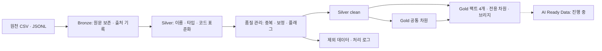

# 데이터 파이프라인



1. **Bronze:** 원천 문자열·JSON 원문을 Parquet로 보존하고 출처·행 번호·SHA-256을 기록합니다. 같은 파일 해시는 기존 적재 시각을 재사용합니다.
2. **Silver 표준화:** 입력 행을 보존하면서 이름·타입·단위·코드를 통일합니다. 매출 합계 행을 분리하고 진료명을 브리지로 펼칩니다.
3. **품질 관리:** 완전 중복을 먼저 분리한 뒤 보정·플래그를 계산합니다. 표준화 결과와 clean을 분리하고 행별 규칙·결정 ID를 기록합니다. 진료 유형 통합은 원래 진료 기록을 보존하며 브리지를 다시 구성합니다.
4. **Gold:** 공용 clean manifest의 버전을 기준으로 공통 차원과 각 grain의 팩트·전용 차원을 생성합니다. PK·FK·행 수·측정값을 대사합니다.
5. **AI Ready Data:** 출전마별 3착 이내 예측 데이터를 구성합니다. 경주 출발 이전 정보를 사용하고 날짜 기준으로 학습·검증을 분할합니다. 완료 후 검증 결과를 추가합니다.

### 실행 순서

저장소 루트에서 실행합니다. 생성 명령은 해당 단계의 산출물을 기록하므로, 기존 결과 확인에는 [검증 명령](Results.md#검증-명령)을 사용합니다.

```powershell
python -m pip install -r requirements.txt

python -X utf8 src/01_bronze.py
python -X utf8 src/01_bronze_check.py
python -X utf8 src/02_normalize.py
python -X utf8 src/02_normalize_check.py
python -X utf8 src/03_quality.py
python -X utf8 src/03_quality_check.py

python -X utf8 src/common/04_common_dims.py
python -X utf8 src/race_entry/04_fct_race_entry.py
python -X utf8 src/horse_medical/04_gold_horse_medical.py
python -X utf8 src/race_sales/build_gold_sales.py
python -X utf8 src/bet_cancel/04_fct_bet_cancel.py

python -X utf8 src/common/04_common_dims_check.py
python -X utf8 src/race_entry/04_fct_race_entry_check.py
python -X utf8 src/horse_medical/04_gold_horse_medical.py --check
```

매출·취소 생성 코드는 내부 검증을 수행합니다. 매출은 [`_validation.json`](https://github.com/encore-ai-campus/mlo-03-p2-team3/blob/develop/data/03_gold/race_sales/_validation.json), 진료는 [`_manifest.json`](https://github.com/encore-ai-campus/mlo-03-p2-team3/blob/develop/data/03_gold/horse_medical/_manifest.json)에 검증 근거를 남깁니다.

### 디렉터리 구조

```text
.
├── data/
│   ├── 00_origin/        # 원천 CSV·JSONL
│   ├── 01_bronze/        # 원문 보존 Parquet 12개
│   ├── 02_silver/        # 표준화 Parquet 14개
│   │   ├── clean/        # 품질 관리 후 Parquet 14개 + manifest
│   │   └── _excluded/    # 중복 제외 마권 1,052행
│   └── 03_gold/
│       ├── common/       # 공통 차원 6개
│       ├── race_entry/    # 경주 출전
│       ├── horse_medical/ # 말 진료
│       ├── race_sales/    # 마권 매출
│       └── bet_cancel/    # 50대 단승 취소
├── src/                  # 단계별 생성·검증 코드
├── docs/                 # AS-IS·단계 보고서·Gold 설계
├── meta/                 # 사전·매핑·결정·적재·품질 로그
├── requirements.txt
└── AGENTS.md             # 저장소 운영 규칙
```

이전 단계 데이터는 다음 단계에서 읽기만 합니다. `main`은 공용 원천·폴더 구조를 공유하고 단계별 산출물은 작업 브랜치에서 관리·통합합니다. 현재 완료 결과의 기준 브랜치는 `develop`입니다.
