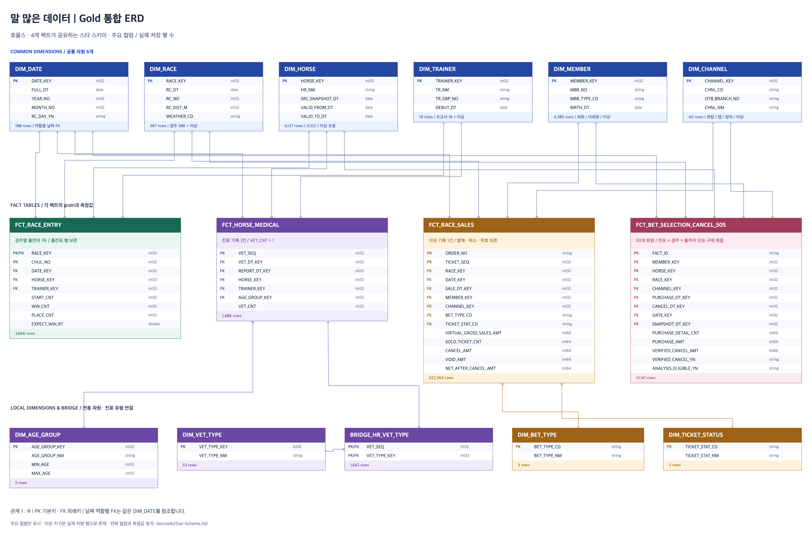

# 스타 스키마

네 팩트가 공통 차원을 공유하는 통합 모델입니다.

[draw.io 편집 원본 다운로드](../diagrams/gold-star-schema.drawio) · [이미지 확대 보기](../diagrams/gold-star-schema.svg)

공통 차원 6개, 팩트 4개, 전용 차원 4개와 진료 브리지의 주요 컬럼·PK·FK를 표시합니다. 원본 파일을 draw.io에서 열어 편집할 수 있습니다.

## 팩트 grain

| 주제 · 팩트 | 한 행의 의미 | PK | 주요 측정값 | 실제 행 수 |
| --- | --- | --- | --- | ---: |
| [경주 출전](../gold/race_entry.md) · `FCT_RACE_ENTRY` | 경주별 출전표에 오른 말 1두 | `RACE_KEY + CHUL_NO` | `START_CNT`, `WIN_CNT`, `PLACE_CNT`, `EXPECT_WIN_RT` | 3,666 |
| [말 진료](../gold/horse_medical.md) · `FCT_HORSE_MEDICAL` | 진료 기록 1건 | `VET_SEQ` | `VET_CNT` | 1,488 |
| [마권 매출](../gold/race_sales.md) · `FCT_RACE_SALES` | 전표 내 마권 기록 1건(발매·취소·무효 포함) | `ORDER_NO + TICKET_SEQ` | `VIRTUAL_GROSS_SALES_AMT`, `SOLD_TICKET_CNT`, `CANCEL_AMT`, `VOID_AMT`, `NET_AFTER_CANCEL_AMT` | 522,364 |
| [50대 단승 취소](../gold/bet_cancel.md) · `FCT_BET_SELECTION_CANCEL_50S` | 만 50~59세 회원의 전표별·경주별·출주마별 단승 구매 묶음 | `FACT_ID` | `PURCHASE_DETAIL_CNT`, `PURCHASE_AMT`, `VERIFIED_CANCEL_AMT`, `VERIFIED_CANCEL_YN` | 41,141 |

## 공통 차원

| 공통 차원 | PK | 행 수(미상 포함) | 주요 속성·연결 기준 |
| --- | --- | ---: | --- |
| `DIM_DATE` | `DATE_KEY` | 188 | 연속 187일 + 미상. 경주·구매·취소·진료·보고·스냅샷 날짜를 역할별 FK로 연결 |
| `DIM_RACE` | `RACE_KEY` | 387 | 경주 386개 + 미상. 경주일·경주번호, 거리·등급·날씨·주로 |
| `DIM_HORSE` | `HORSE_KEY` | 4,127 | 말 1,250두의 SCD2 버전 4,126개 + 미상. 기준일 이전 스냅샷 사용 |
| `DIM_TRAINER` | `TRAINER_KEY` | 19 | 조교사 18명 + 미상. 조교사명·소속 조 |
| `DIM_MEMBER` | `MEMBER_KEY` | 4,385 | 회원 4,383명 + 비회원 + 미상. 비회원은 별도 양수 키 |
| `DIM_CHANNEL` | `CHANNEL_KEY` | 40 | 현장·앱·장외 37개 지점 + 미상. 채널·지점 조합 |

미상 키는 `0`입니다. 말의 SCD2 버전은 스냅샷 다음 날부터 유효하며, `VALID_FROM_DT ≤ 기준일 ≤ VALID_TO_DT`로 연결합니다.

전용 차원은 진료의 `DIM_AGE_GROUP` 5행·`DIM_VET_TYPE` 53행, 매출의 `DIM_BET_TYPE` 3행·`DIM_TICKET_STATUS` 3행입니다. 진료 유형 브리지 `BRIDGE_HR_VET_TYPE`은 1,662행입니다.

상세 규칙은 [공통 차원 문서](../gold/common.md)를 따릅니다.

## 측정값

| 팩트 | 측정값 | 입력과 계산 정의 |
| --- | --- | --- |
| 출전 | `START_CNT`, `WIN_CNT`, `PLACE_CNT` | clean `RC_RESULT`에서 출주(`RAN`) 1, 1착 1, 3착 이내 1. 미출주마는 0 |
| 출전 | `EXPECT_WIN_RT` | clean `RC_ODDS.WIN_ODDS`의 역수를 경주별 역수 합으로 나눈 값. 미출주마는 0 |
| 진료 | `VET_CNT` | clean `HR_VET_HIST`의 진료 기록 1건당 1. 유형을 넘나들어 집계할 때는 `VET_SEQ` 중복 제거 |
| 매출 | `VIRTUAL_GROSS_SALES_AMT`, `SOLD_TICKET_CNT` | clean `BET_TICKET`에서 `INVALID_YN=N`인 `SOLD`의 금액과 행 수, 나머지 0 |
| 매출 | `CANCEL_AMT`, `VOID_AMT`, `NET_AFTER_CANCEL_AMT` | 유효 `CANCEL` 금액의 부호를 반전, 유효 `VOID` 금액은 별도 집계. 취소 차감 후 금액 = 정상 발매액 − 취소액 |
| 취소 | `PURCHASE_DETAIL_CNT`, `PURCHASE_UNIT_CNT`, `PURCHASE_AMT` | 구매 당시 만 50~59세 회원의 0원 제외 단승 구매 상세를 전표·경주·출주마별로 묶어 건수·구좌·금액 합산 |
| 취소 | `VERIFIED_CANCEL_AMT`, `VERIFIED_CANCEL_YN` | 원전표·회원·선택이 일치하고 상세 검증을 통과한 취소 금액의 절댓값 합계, 취소 유무. 판정 불명확은 NULL |
| 취소 | `Y1_WIN_RT`, `TOT_WIN_RT` | 구매일보다 앞선 최신 말 스냅샷의 최근 1년·통산 1착수 ÷ 출전수. 분모 0·유효하지 않은 전적은 NULL |

금액은 원 단위입니다. 매출의 취소 차감 후 금액에는 무효액을 추가 차감하지 않습니다. 마권 매출은 WIN·PLC·QNL 입력 기준이며 별도 `RC_SALES`의 7개 승식 매출과 동일한 모집단으로 가정하지 않습니다. `EXPECT_WIN_RT`은 최종 배당 기반이므로 후속 예측 데이터에서는 이용 가능한 시점을 검토해야 합니다.
